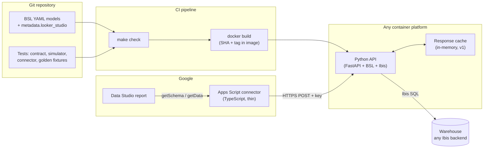
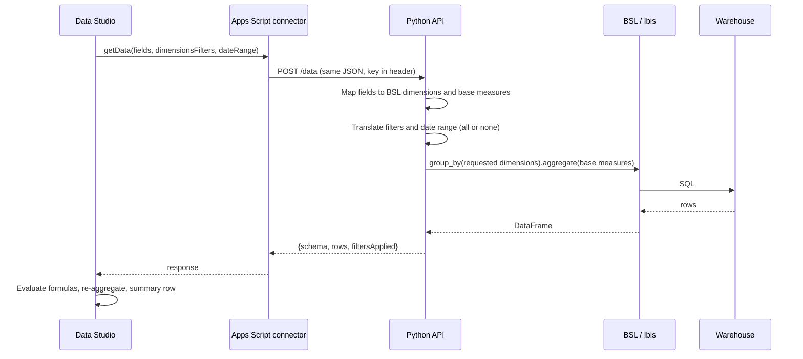
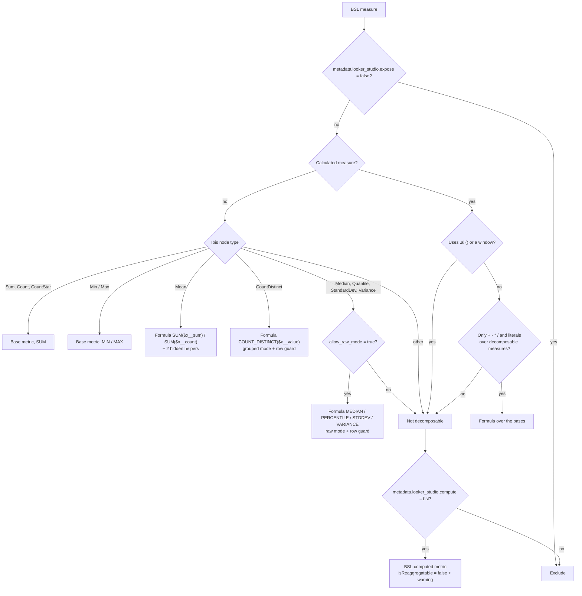
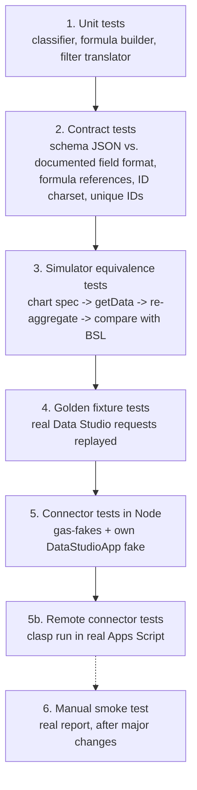
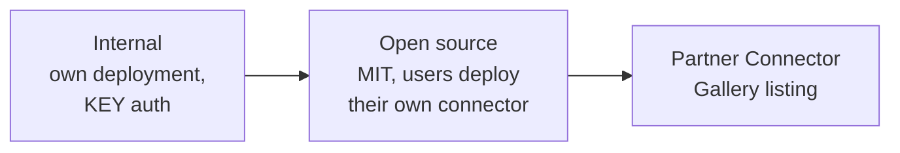

# Research baseline: Data Studio connector for the Boring Semantic Layer

| Item | Value |
|---|---|
| Status | Baseline for a new code repository. Research only. Updated 2026-11-14 with evidence from a real Data Studio report (section 7.8). Updated 2026-11-15 with the classifier decision (section 7.9). |
| Date | 2026-11-14 |
| Writing standard | [ASD-STE100 Simplified Technical English](https://www.asd-ste100.org/) rules. Technical names (getData, Ibis, Docker) are permitted. |
| Versions tested | boring-semantic-layer 0.3.19, ibis-framework 11.0.0, duckdb 2.0.0, Python 3.12 |
| Evidence code | [`spikes/spike_bsl_data_studio.py`](../spikes/spike_bsl_data_studio.py), [`spikes/spike_distinct_and_limits.py`](../spikes/spike_distinct_and_limits.py), [`spikes/spike_function_semantics.py`](../spikes/spike_function_semantics.py), [`spikes/spike_compute_location.py`](../spikes/spike_compute_location.py), [`spikes/spike_property_based.py`](../spikes/spike_property_based.py), [`spikes/flights.yml`](../spikes/flights.yml) and the live prototype [`prototype/`](../../prototype/README.md) (API, connector, golden fixtures in `prototype/fixtures/`) |
| Follow-up | Detailed design is out of scope for all parts. Wayfinder specifies it, with this document as input (section 13.1). |

## 1. Purpose and scope

This document defines the baseline for a Data Studio community connector. The connector gives Data Studio access to metrics and dimensions from the Boring Semantic Layer (BSL). The connector also gives the descriptions of these fields.

The document has these objectives:

1. Record the decisions that the team made (section 3).
2. Prove each technical claim with evidence from documentation or code (sections 5 to 7 and 10).
3. Identify the claims that are not verified. Each such claim becomes a required test (section 12).

The document does not contain implementation code or detailed design. The spike code is evidence only. Wayfinder does the detailed design (section 13.1).

**Product name.** Google renamed Looker Studio to "Data Studio". This document uses "Data Studio" (LS-21).

## 2. Terms

| Term | Definition |
|---|---|
| BSL | Boring Semantic Layer. A Python semantic layer on top of Ibis. |
| Model | One BSL semantic model. It has dimensions, measures, calculated measures and joins. |
| Base measure | A BSL measure that is a direct aggregation of a column, for example `_.distance.sum()`. |
| Calculated measure | A BSL measure that refers to other measures by name, for example `_.total_distance / _.flight_count`. |
| Decomposable | A measure is decomposable when Data Studio can calculate the correct value for any grain from values at a finer grain. |
| Prove safe or exclude | The classification rule. The connector exposes a measure as a normal metric only when it can prove that the measure is decomposable. |
| Helper field | A hidden field that the connector adds to make a formula possible, for example the sum and the non-NULL count for a mean. |
| Grain | The set of dimensions that a query groups by. |
| Simulator | A Python model of the Data Studio behavior that this project needs. Tests use it in place of Data Studio. |
| Golden fixture | A real getData request from Data Studio, saved as a file and used in tests. |

## 3. Decisions

These decisions set the direction for the detailed design. They are inputs for Wayfinder. Names, values and formats in them (for example the `__bsl` suffix, the 500,000-row cap, the 300-second timeout and the `metadata.looker_studio` keys) are proposals. Wayfinder can change them. A change must keep the evidence in sections 5 to 7 and 10 valid.

| ID | Decision |
|---|---|
| D-01 | The document is a research baseline. It contains no implementation code and no detailed design. Wayfinder does the detailed design. |
| D-02 | The service supports all Ibis backends. Tests and CI use DuckDB. |
| D-03 | The API runs in a Docker image. The image runs on any cloud provider. |
| D-04 | Distribution is internal first. The project will become open source and published later. |
| D-05 | The connector excludes measures that it cannot express reliably as Data Studio formulas. This is the default. Configuration can change it per measure. |
| D-06 | The user selects an environment (`prod` or `dev`) in the connector configuration. The field descriptions show the model version. |
| D-07 | Each claim has an ID, a source link and a status. |
| D-08 | The document uses ASD-STE100 rules without a word-by-word dictionary audit. |
| D-09 | The document is a Markdown file in the repository. |
| D-10 | The connector derives the treatment of each measure from the BSL expression (section 6). |
| D-11 | Per-field overrides live in BSL `metadata` under the key `looker_studio`. |
| D-12 | The Docker image contains the models. The build records the git SHA and tag in the image. |
| D-13 | Version 1 identifies each user: Google identity token (A-3) first, then OAuth2 with the organisation's identity provider (A-5). No shared key in the connector. The authentication layer is pluggable. Row-level security is not in scope for version 1. Decision record: section 11.3.1. |
| D-14 | One Data Studio data source maps to one BSL model, including its joins. |
| D-15 | Each model exposes one primary time dimension at day grain. The connector sets `dateRangeRequired` to true. |
| D-16 | The simulator covers the table body, the summary row, the scorecard, dimension filters, the date range and date-grain bucketing. Blends, comparison periods and report-level calculated fields are not in scope. |
| D-17 | The document includes a release-readiness section (section 11). |
| D-18 | The connector is written in TypeScript and deployed with `clasp`. Tests run in Node. |
| D-19 | Version 1 uses an in-memory response cache behind an interface. The cache key contains the model version and the normalized request. |
| D-20 | The connector translates BSL aggregations to Data Studio formula functions when a spike proves the result correct on the rows that the connector returns (section 7.6). |
| D-21 | The API never truncates a response. When a response would exceed a limit, the API returns an error (section 10.3). |
| D-22 | The connector builds the schema with the `DataStudioApp` field builder and `setFormula` with `$` references (LS-04). It does not return raw schema JSON. This removes U-11. |
| D-23 | Formulas always refer to base or helper fields, never to other formula fields. This removes U-09. |
| D-24 | The API pushes regular expression filters down only to backends that use RE2 (LS-38, E-16). For other backends it sets `filtersApplied` to false. |
| D-25 | Each measure has a compute location: Data Studio calculates it from base or raw fields, or BSL calculates it for each requested group. The default is chosen by the classifier. A measure can override it (section 7.7). |
| D-26 | The connector uses TypeScript, a bundler with an Apps Script plugin, and `clasp`. It has local tests with fakes and remote tests that run connector functions in Apps Script (section 14). |
| D-27 | The project copies no code from GPL-licensed or unlicensed repositories. It reuses only ideas from them (section 14.1). |
| D-28 | `compute: both` generates two fields from one BSL measure: an exact `data_studio` field with the plain ID and a fixed-grain `bsl` field with the ID suffix `__bsl` (section 7.7). |

## 4. Architecture

### 4.1 Components



The API does all semantic work. The Apps Script connector only forwards requests and responses. This keeps almost all logic in Python, where an agent can run tests without Google services.

### 4.2 getData request flow



### 4.3 Reuse of the BSL server

BSL 0.3.19 contains a FastAPI server (BSL-06). It has model loading, model schema routes, a query route and an authentication hook. The first recommendation was to add the Data Studio routes to the app that `create_app` returns. **Decided 2026-11-15 (O-01):** the project does not host its routes in that app. It is a separate package that uses BSL as a library (section 4.3.1).

### 4.3.1 Decision on the BSL server (2026-11-15)

Result of a grilling session on O-01. Facts from `server/api.py` and `server/loader.py` of BSL 0.3.19:

- `create_app` accepts one `auth_hook` of type `Request -> bool` (or `api_key`, not both). A middleware calls it for every path except `/health` and `OPTIONS`. It cannot return a principal.
- The app always has the routes `/query` (up to 100,000 rows), `/compare-periods`, `/models/{name}/schema` and `/models/{name}/dimensions/{dim}/values` (up to 1,000 values). No setting removes them.
- App-wide exception handlers change every `ValueError` to 400 and every other exception to 500 `Internal server error`.
- BSL has no plugin point for the server. Its only entry points are the `bsl` CLI and a xorq tag handler. `bsl serve` calls `create_app` directly.
- `load_models` reads a Python file (`BSL_CONFIG_PATH`, default `semantic_config.py`) that defines a mapping `MODELS`.

| ID | Decision |
|---|---|
| AD-14 | The Data Studio routes are not hosted in the app of `create_app`. Reasons: its extra routes give each accepted viewer full query access past our limits (AD-10, AD-11, R-01); one bool hook cannot give a principal or run several authenticators (AD-01, AD-05); its app-wide handlers hide the typed errors that the connector needs. This replaces the first recommendation of section 4.3. |
| AD-15 | The API is an installable Python package that depends on BSL. It has two layers: a mountable FastAPI `APIRouter`, and a minimal standalone app with only `/health` and the Data Studio routes. Production and the Docker image (D-03) use the standalone app. Mounting the router into a BSL app is possible but not recommended (AD-10). |
| AD-16 | The API loads models with BSL `load_models` (`BSL_CONFIG_PATH`, `MODELS` mapping). YAML stays the authoring format and is loaded inside the config file. One model repository serves `bsl serve` and this API. |
| AD-17 | The API pins `boring-semantic-layer==0.3.19`. A version change is intentional and must pass `make check` and the spikes as contract tests. `docs/bsl-gotchas.md` lists the BSL internals that the API uses. |
| AD-18 | Names: distribution `boring-data-studio`, import `boring_data_studio`, one CLI `bsl-datastudio` with the commands `serve` and `new-key` (replaces `bsl-api` in AD-09). `requires-python >=3.12`. The package depends on `fastapi` directly, not on `boring-semantic-layer[server]`; only the mounted mode needs that extra. |
| AD-19 | The router enforces the authenticators (AD-05) as a router-level FastAPI dependency in every host. The principal comes from this dependency. In a BSL host, the BSL `auth_hook` is only an additional outer gate. |
| AD-20 | The router registers no app-wide exception handlers. Each route catches its errors and returns the typed error body of the API contract (user error or system error). |
| AD-21 | The router uses relative paths (for example `/schema`, `/data`). The host sets the prefix: the standalone app mounts at the root. The connector API URL includes the prefix. Path versioning is part of the API contract (section 13.1). |
| AD-22 | Internal stage (D-04): install from a git tag (`uv add "git+https://…@<tag>#subdirectory=api"`) and from the Docker image. Publication on PyPI starts when the project becomes open source. |
| AD-23 | Repository layout: `api/` (uv project, src layout `api/src/boring_data_studio/`, `api/tests/`) and `connector/`. `prototype/` stays frozen as evidence. `make check` moves to `api/` when the package passes the schema self-check and the fixture replay. |

## 5. Evidence: Data Studio connector contract

Status values: **Doc** (confirmed by official documentation), **Code** (confirmed by code or by a spike), **Secondary** (third-party source only), **Unverified** (needs a test, see section 12).

Primary sources:

- API reference: <https://developers.google.com/data-studio/connector/reference>
- Calculated fields: <https://developers.google.com/data-studio/connector/calculated-fields>
- Filters: <https://developers.google.com/looker-studio/connector/filters>
- Semantic types: <https://developers.google.com/looker-studio/connector/semantics>
- Partner Connector requirements: <https://developers.google.com/data-studio/connector/pscc-requirements>
- Local development: <https://developers.google.com/data-studio/connector/local-development>
- Apps Script quotas: <https://developers.google.com/apps-script/guides/services/quotas>

| ID | Claim | Source | Status |
|---|---|---|---|
| LS-01 | A connector implements `getAuthType`, `getConfig`, `getSchema` and `getData`. Key authentication also needs `isAuthValid`, `resetAuth` and `setCredentials`. | API reference | Doc |
| LS-02 | A field `name` is the unique identifier. Only letters, digits and underscores are permitted. A BSL join name such as `carriers.name` must therefore become `carriers__name`. | API reference, Field | Doc |
| LS-03 | A field has `label`, `description`, `dataType`, `group`, `formula`, `isHidden`, `isDefault`, `defaultAggregationType` and `semantics`. The description is plain text only. | API reference, Field | Doc |
| LS-04 | A formula refers to another field ID with a `$` prefix, for example `SUM($cost) / SUM($units)`. Function names cannot be field IDs. | Calculated fields | Doc |
| LS-05 | A formula that contains an aggregation needs the aggregation `AUTO`. A formula without an aggregation needs `NONE`. | Calculated fields | Doc |
| LS-06 | Data Studio drops a field with an invalid formula. It does not show an error. | API reference, `formula` | Doc |
| LS-07 | When a field has a formula, Data Studio ignores the aggregation properties. A formula set by the connector cannot be edited in the fields editor. | API reference, `formula` | Doc |
| LS-08 | A hidden field does not appear in the field pickers, but formulas can use it. A formula field cannot be hidden. | API reference, `isHidden` | Doc |
| LS-09 | When `isReaggregatable` is false, the aggregation is "Auto" and the user cannot change it. The property applies only to metrics. The default is true. | API reference, `semantics` | Doc |
| LS-10 | When one field has `semantics.semanticType`, Data Studio disables automatic semantic detection. | API reference, `semantics` | Doc |
| LS-11 | The getData request contains `fields`, `dimensionsFilters`, `dateRange` and `scriptParams`. It contains no information about the expected aggregation. The connector must return rows at the grain of the requested dimensions. | API reference, getData; [Databricks forum](https://community.databricks.com/t5/warehousing-analytics/databricks-connector-for-looker-studio-no-aggregation-pushdown/m-p/115364) (Secondary) | Doc |
| LS-12 | getData returns at most 1 million rows. | API reference, getData | Doc |
| LS-13 | When a request has more than 20 fields, Data Studio sends more than one getData request. It groups the fields 20 at a time. | API reference, getData **Contradicted for 21 and 22 fields (E-34): Data Studio sent one request.** The split threshold, if any, is higher. | API reference, getData; E-34 | Doc, contradicted by Code |
| LS-14 | In `dimensionsFilters`, the connector must OR the clauses in each inner array and AND the outer arrays. Each clause has `fieldName`, `values`, `type` (INCLUDE or EXCLUDE) and `operator`. | API reference; Filters | Doc |
| LS-15 | The filter operators are EQUALS, CONTAINS, REGEXP_PARTIAL_MATCH, REGEXP_EXACT_MATCH, IN_LIST, IS_NULL, BETWEEN and four NUMERIC comparison operators. | API reference, Filter Operator | Doc |
| LS-16 | The connector must apply all filters or no filters. When it applies them, it removes the `forFilterOnly` fields and sets `filtersApplied` to true. When it does not apply them, it returns the `forFilterOnly` fields and sets `filtersApplied` to false. Data Studio then applies the filters. | Filters | Doc |
| LS-17 | `dateRange` uses `YYYY-MM-DD`. It is present only when `dateRangeRequired` is true. The default range is the last 28 days without today. | API reference, getData | Doc |
| LS-18 | A `YEAR_MONTH_DAY` value uses the format `YYYYMMDD`. | API reference, SemanticType | Doc |
| LS-19 | `scriptParams.sampleExtraction` is true when the request is for semantic type detection. | API reference; Semantic types | Doc |
| LS-20 | The auth types include `KEY` and `PATH_KEY`. `PATH_KEY` collects a path and a key from the user. | API reference, AuthType and setCredentials | Doc |
| LS-21 | Looker Studio is now called Data Studio. | Banner on the [Data Studio documentation](https://docs.cloud.google.com/data-studio/stddev) | Doc |
| LS-22 | "Field editing in reports" is on by default for new data sources. A data source editor can turn it off. When it is on, report editors can change field names and aggregations. Metrics with the aggregation "Auto" cannot be changed. | [Edit fields in your reports](https://support.google.com/datastudio/answer/7512288); [Model your data](https://docs.cloud.google.com/looker/docs/studio/model-your-data) | Doc |
| LS-23 | The summary row of a table calculates a formula again from the aggregated totals. It does not add the row values. | [Dataslayer](https://support.dataslayer.ai/discrepancy); [Google: blending to re-aggregate](https://docs.cloud.google.com/looker/docs/studio/use-blending-to-reaggregate-data) | Secondary, see U-02 |
| LS-24 | When a chart filter forces Data Studio to aggregate a pre-aggregated ratio metric again, Data Studio shows the error "Unable to aggregate ratio metrics". | [Google help](https://docs.cloud.google.com/looker/docs/studio/what-does-the-unable-to-aggregate-ratio-metrics-error-mean) | Doc, see U-07 |
| LS-25 | Apps Script limits: 6 minutes runtime per execution; per URL Fetch call 50 MB response, 50 MB POST body, 2 KB URL, 100 headers and 8 KB header size; 20,000 (consumer) or 100,000 (Workspace) URL Fetch calls per user per day. | Apps Script quotas | Doc |
| LS-26 | `dscc-gen` and `clasp` support local development. They push code, open deployments and update the `Production` deployment from the command line. | Local development | Doc |
| LS-27 | A Partner Connector needs: a `Production` deployment, a manifest with `addOnUrl`, `supportUrl`, `logoUrl`, privacy policy and terms URLs, explicit `oauthScopes`, a `urlFetchWhitelist` (or an exception), and OAuth client verification for all auth types. The name must not contain the word "connector". | Partner Connector requirements | Doc |
| LS-28 | The Data Studio formula functions include these aggregations: `SUM`, `COUNT`, `COUNT_DISTINCT`, `APPROX_COUNT_DISTINCT`, `AVG`, `MIN`, `MAX`, `MEDIAN`, `PERCENTILE(X, N)` and `STDDEV`. | [Function list](https://docs.cloud.google.com/data-studio/function-list) | Doc |
| LS-29 | Data Studio keeps queries and their results in memory. It serves a query from memory when it saw the same query before and the freshness threshold is not exceeded. A new query always goes to the data source. With owner's credentials, all viewers share one freshness state. With viewer's credentials, each viewer has their own. The manual refresh cooldown is one minute. Google lists the freshness options for community connectors as "varies". | [Manage data freshness](https://docs.cloud.google.com/data-studio/manage-data-freshness) | Doc |
| LS-30 | Apps Script allows 30 simultaneous executions per user and 1,000 per script. Daily quotas reset 24 hours after the first request. Google can change all quotas and limits without notice. | Apps Script quotas | Doc |
| LS-31 | A connector vendor recommends fewer than 100,000 rows per data source for performance, and fewer than 30 data connections per report because of the simultaneous execution limit. The same vendor states a 12-hour freshness for community connectors. | [Civis connector documentation](https://support.civisanalytics.com/hc/en-us/articles/360043612111) | Secondary |
| LS-32 | The effective user of a connector is the data source owner (owner's credentials) or the report viewer (viewer's credentials). A connector can force viewer's credentials with `forceViewersCredentials` in the manifest. | [Access user identity](https://developers.google.com/data-studio/connector/user-identity); [Force viewer's credentials](https://developers.google.com/data-studio/connector/force-viewers-credentials); [Manifest](https://developers.google.com/looker-studio/connector/manifest) | Doc |
| LS-33 | A Workspace administrator can turn off community connectors or Apps Script for the organization. Then charts from community connectors cannot fetch data. | [Community connector errors](https://docs.cloud.google.com/data-studio/community-connector-errors) | Doc |
| LS-34 | Only connector admins see error details. Other users see a message only when the connector throws it with `newUserError()`. | [Error handling](https://developers.google.com/data-studio/connector/error-handling) | Doc |
| LS-35 | A direct link `datasources/create?connectorId=DEPLOYMENT_ID` opens Data Studio with the connector selected. `connectorConfig` (URL-encoded JSON) fills the configuration. `reportTemplateId` sets a report template. | [Direct links](https://developers.google.com/data-studio/connector/direct-links) | Doc |
| LS-36 | The Data Studio API only searches assets and manages permissions. It works only for Workspace users whose organization authorized the app with domain-wide delegation. | [Data Studio API](https://developers.google.com/data-studio/integrate/api); [API reference](https://developers.google.com/data-studio/integrate/api/reference) | Doc |
| LS-37 | The Linking API creates a report from a template report with a URL. It can configure the data sources of the report. Community connector support through a `connectorId` parameter is described by a third party. | [Linking API](https://developers.google.com/data-studio/integrate/linking-api); [API Evangelist](https://raw.githubusercontent.com/api-evangelist/google-data-studio/refs/heads/main/capabilities/linking-reports.yaml) | Doc; `connectorId`: Secondary |
| LS-38 | Data Studio uses the RE2 regular expression syntax. DuckDB also uses RE2. | [REGEXP_MATCH](https://docs.cloud.google.com/data-studio/regexpmatch); [DuckDB](https://duckdb.org/docs/current/sql/functions/regular_expressions) | Doc |
| LS-39 | Documentation examples for the input 95, 100, 92: `PERCENTILE(x, 30.5)` = 93.83, `STDDEV` = 3.3, `VARIANCE` = 10.89. These are linear-interpolation percentile and population statistics (E-13, E-14). | [PERCENTILE](https://docs.cloud.google.com/data-studio/percentile); [STDDEV](https://docs.cloud.google.com/data-studio/stddev); [VARIANCE](https://docs.cloud.google.com/data-studio/variance) | Doc + Code |
| LS-40 | `COUNT_DISTINCT` takes a dimension or a non-aggregated expression. It does not accept metrics or fields with the aggregation "Auto". NULL handling can differ between systems. | [COUNT_DISTINCT](https://docs.cloud.google.com/data-studio/countdistinct) | Doc |
| LS-41 | A connector name in the manifest has at most 28 characters. | [Manifest](https://developers.google.com/looker-studio/connector/manifest) | Doc |
| LS-42 | A connector vendor reports a Data Studio timeout message for slow requests. The timeout value is not documented. | [Two Minute Reports](https://twominutereports.com/help/google-data-studio/troubleshooting) | Secondary |
| LS-43 | `@types/google-apps-script` 2.0.15 types `DataStudioApp`, including `setFormula`, `setIsHidden`, `setIsReaggregatable`, `newUserError` and the getData request. The request type does not include `forFilterOnly`. `@google/clasp` 3.4.1 and `@google/dscc-gen` 2.0.31 are on npm. | npm registry, package contents | Code |
| LS-44 | Chart cross-filtering is on by default for charts based on community connectors. Cross-filtering can increase the number of requests to the connector. | [Connector changelog](https://developers.google.com/looker-studio/connector/changelog) | Doc |
| LS-45 | Google's own Looker connector limits charts to 5,000 rows and queries to 5 minutes. Its data sources permit calculated fields only on dimensions, with a subset of functions. | [Looker connector limits](https://docs.cloud.google.com/data-studio/limits-of-the-looker-connector) | Doc |
| LS-46 | The native PostgreSQL connector uses the PostgreSQL JDBC driver and connects a data source to one table in the `public` schema, or to a custom query. Data Studio uses a custom query as the inner SELECT of each query it generates. Documented data types are numeric, character and boolean. Queries can time out after 3 to 5 minutes. A firewall must allow the Data Studio IP addresses. Private IP connections to Cloud SQL are not supported. | [Connect to PostgreSQL](https://docs.cloud.google.com/looker/docs/studio/connect-to-postgresql) | Doc |
| LS-47 | Data Studio fills field descriptions automatically only for the Looker and Search Ads 360 connectors. | [Edit a data source](https://cloud.google.com/looker/docs/studio/edit-a-data-source-article) | Doc |
| LS-48 | Cube's SQL API exposes each cube as a table and each measure as a column. It accepts `MEASURE()` for every measure type, and a standard aggregate only when it matches the measure type. Cube built a query rewrite system for this, because SQL has no native measure concept. | [Cube SQL API query format](https://cube.dev/docs/product/apis-integrations/sql-api/query-format); [Cube blog](https://cube.dev/blog/about-query-interfaces-for-olap-systems) | Doc (vendor) |
| LS-49 | The `DataStudioApp` field builder rejects `setAggregation` on a field with `isReaggregatable` false. `getSchema` throws "Cannot set aggregation type for field ... since it is not reaggregatable". A `compute: bsl` field must have no aggregation. | Prototype, Data Studio error ID f6b07b34 | Code |
| LS-50 | A table with a summary row sends two getData requests: one with the dimensions and one without dimensions. Data Studio calculates the summary row from the second response. It does not sum the rows of the first response. | Prototype fixtures (E-23) | Code |
| LS-51 | A direct link with `connectorConfig` fills the connector configuration. The "Data freshness" option offered for this connector is 12 hours. "Field editing in reports" is on by default. | Prototype data source page | Code |
| LS-52 | Data Studio also caches a failed getData result. The same query shows the cached error until the query or the data source configuration changes. | Prototype, error ID 8dbb1c0c after a tunnel drop | Code |
| LS-53 | The connector auth types are `NONE`, `OAUTH2`, `KEY`, `USER_PASS`, `USER_TOKEN`, `PATH_USER_PASS` and `PATH_KEY`. `OAUTH2` uses the `apps-script-oauth2` library and needs `get3PAuthorizationUrls`, `authCallback`, `isAuthValid` and `resetAuth`. | [Connector auth](https://developers.google.com/looker-studio/connector/auth); [AuthType](https://developers.google.com/looker-studio/connector/reference#authtype) | Doc |
| LS-54 | `ScriptApp.getIdentityToken()` returns an OpenID Connect ID token (a JWT signed by Google) for the effective user when the script has the `openid` scope; the email claim needs the `userinfo.email` scope. The token's audience is the OAuth client ID of the script's Google Cloud project. A receiver verifies it against Google's public certificates. | [ScriptApp.getIdentityToken](https://developers.google.com/apps-script/reference/script/script-app#getIdentityToken()); [Verify Google ID tokens](https://developers.google.com/identity/sign-in/web/backend-auth) | Doc |
| LS-55 | `ScriptApp.getOAuthToken()` returns the effective user's OAuth access token for the script's scopes. A receiver can check it with Google's token-info endpoint. | [ScriptApp.getOAuthToken](https://developers.google.com/apps-script/reference/script/script-app#getOAuthToken()) | Doc |
| LS-56 | Cloud Run can require IAM authentication (`roles/run.invoker`) and accepts ID tokens whose audience is the service URL or a configured custom audience. | [Cloud Run authentication](https://cloud.google.com/run/docs/authenticating/overview); [Custom audiences](https://cloud.google.com/run/docs/configuring/custom-audiences) | Doc |
| LS-57 | Apps Script `UserProperties` are visible only to the user who stored them; `ScriptProperties` are shared by all users and editors of the script. | [Properties service](https://developers.google.com/apps-script/guides/properties) | Doc |
| LS-58 | Data Studio "Service Account Credentials" work only for BigQuery data sources. They need a Google Workspace or Cloud Identity organisation. An admin grants the Data Studio service agent `roles/iam.serviceAccountTokenCreator` on a Google Cloud service account. The service account gets read access to the tables. Data source editors need `roles/iam.serviceAccountUser`. Viewers need no permissions. The pages do not mention community connectors. | [Data credentials](https://docs.cloud.google.com/looker/docs/studio/data-credentials-article); [Set up a service account](https://docs.cloud.google.com/looker/docs/studio/set-up-a-google-cloud-service-account-for-looker-studio) | Doc |
| LS-59 | For community connectors, Google documents a different service-account pattern: `getAuthType` returns `NONE`, the service-account credentials are stored in `ScriptProperties`, and `getData` creates a token with `apps-script-oauth2`. The example is BigQuery-specific, but the pattern applies to any platform. Google says script properties hide the credentials from code viewers. Per LS-57, they are still readable by script editors. | [Use a service account](https://developers.google.com/looker-studio/connector/use-a-service-account) | Doc |
| LS-60 | The `apps-script-oauth2` library supports PKCE: `generateCodeVerifier()`, `setCodeVerififer()` (sic) and a code challenge method, in `src/Service.js`. The README does not document it. | [apps-script-oauth2 `src/Service.js`](https://github.com/googleworkspace/apps-script-oauth2/blob/main/src/Service.js) | Code |
| LS-61 | The audience (`aud`) of a `getIdentityToken()` token is the script's OAuth client ID. The guide gives no way to set a different audience in the script; the receiving service must allow that client ID. Community reports describe audience mismatches, so T-1 must log `aud`. | [Connect to Google Cloud services](https://developers.google.com/apps-script/guides/services/cloud-run); [ScriptApp](https://developers.google.com/apps-script/reference/script/script-app) | Doc |
| LS-62 | For `OAUTH2`, the documented OAuth service (authorize URL, token URL, client ID, secret) is set in the script code. The connector "should not rely on connector configuration" to obtain credentials. | [Connector auth](https://developers.google.com/looker-studio/connector/auth) | Doc |
| LS-63 | The published Matomo connector uses auth type `USER_TOKEN`: the "username" field holds the Matomo instance URL, the token is the user's personal Matomo auth token. `setCredentials` validates both with an API call and stores them in `UserProperties`. Identity and permissions come from Matomo's own user system. The manifest has no `urlFetchWhitelist`. | [`src/auth.ts`, `src/appsscript.json`](https://github.com/matomo-org/looker-studio-connector) (read 2026-11-15) | Code |
| LS-64 | The dbt Semantic Layer connector reads its auth token from `request.configParams` (data source configuration), not from an auth type. The Cube connector uses `OAUTH2`. | [anouardbt/dbt-sl-looker-studio `src/Code.gs`](https://github.com/anouardbt/dbt-sl-looker-studio); [chaos87/datastudio_cube_connector `Code.gs`](https://github.com/chaos87/datastudio_cube_connector) | Code |

## 6. Evidence: Boring Semantic Layer

Primary sources:

- Repository: <https://github.com/boringdata/boring-semantic-layer>
- Package: <https://pypi.org/project/boring-semantic-layer/>
- Installed code: `boring_semantic_layer` 0.3.19 (files named below)

| ID | Claim | Source | Status |
|---|---|---|---|
| BSL-01 | The YAML format accepts `expr`, `description` and `metadata` for dimensions and measures. Dimensions also accept `is_entity`, `is_event_timestamp`, `is_time_dimension`, `smallest_time_grain` and `derived_dimensions`. | `yaml.py`, `_parse_expression_config` | Code |
| BSL-02 | `metadata` is a free-form dict. It is kept on the `Dimension` and `Measure` objects and appears in `json_definition`. | `ops/_values.py`; spike E-01 | Code |
| BSL-03 | A model accepts only these top-level keys: `table`, `description`, `database`, `dimensions`, `measures`, `calculated_measures`, `joins`, `filter`, `profile`. An unknown key causes `DefinitionError`. Model-level connector settings therefore cannot be top-level model keys. | `yaml.py`, `_MODEL_KEYS` | Code |
| BSL-04 | A calculated measure is a function of a scope. It refers to other measures by name. It can call `.all()` for totals, for example percent of total. | `yaml.py`, `_parse_calc_measure` | Code |
| BSL-05 | A base measure resolves to an Ibis reduction node: `CountStar`, `Sum`, `Mean`, `Max`, `CountDistinct`, `Median`. The connector can read the node type. | Spike E-02 | Code |
| BSL-06 | BSL ships a FastAPI server. It has the routes `/health`, `/models`, `/models/{name}/schema`, `/query` and others. `create_app` accepts an `auth_hook` or an API key (`BSL_API_KEY`). The key goes in the `X-BSL-API-Key` header or as a bearer token. The query `limit` is at most 100,000. | `server/api.py` | Code |
| BSL-07 | BSL filter dicts support `=`, `!=`, `<`, `<=`, `>`, `>=`, `like`, `not like`, `ilike`, `not ilike`, `in`, `not in`, `is null`, `is not null`, and nested `AND` / `OR`. They do not support regular expressions. | `predicate.py`; spike E-07 | Code |
| BSL-08 | A callable filter with Ibis `re_search` gives regular expression filtering. | Spike E-07 | Code |
| BSL-09 | `time_range` requires the time dimension in the query dimensions. The connector must send the Data Studio date range as a normal filter. | `query.py`; spike E-08 | Code |
| BSL-10 | BSL has an internal analyzer for calculated measures (`calc_analyzer.py`). It is internal and can change. The connector must not depend on it. | `calc_analyzer.py` | Code |
| BSL-11 | BSL uses the MIT license. It requires `ibis-framework` 11.x. | Package metadata | Code |
| BSL-12 | BSL supports all engines that Ibis supports, for example DuckDB, Snowflake, BigQuery and PostgreSQL. | [BSL README](https://github.com/boringdata/boring-semantic-layer) | Doc |

## 7. Metric classification: "prove safe or exclude"

### 7.1 Why the rule is necessary

Data Studio receives rows at the grain of the requested dimensions (LS-11). It then aggregates these rows again for coarser grains and for the summary row. A measure gives correct values only when this second aggregation is correct. Spike results ([`spike_bsl_data_studio.py`](../spikes/spike_bsl_data_studio.py), [`spike_distinct_and_limits.py`](../spikes/spike_distinct_and_limits.py), [`spike_function_semantics.py`](../spikes/spike_function_semantics.py)):

| Experiment | Result | Conclusion |
|---|---|---|
| E-04 | Sum, count, max, ratio of sums and decomposed mean, re-aggregated from (origin, date) to (origin), are equal to the BSL values. | Decomposable measures are safe. |
| E-05 | True total of `distance_per_flight` is 300.0. The sum of the row ratios is 983.33. A formula on the summed bases gives 300.0. | Ratios must be formulas on additive bases. |
| E-05 | `avg_distance` (mean) is 360.0. `total_distance / flight_count` is 300.0, because one distance is NULL. | The mean helper count must be the non-NULL count of the column, not `COUNT(*)`. |
| E-06 | Distinct carriers: total 3, sum of per-origin values 5. | A distinct count is not decomposable as a number. Section 7.6 gives a formula translation that is correct. |
| E-09 | `COUNT_DISTINCT` calculated on rows grouped by (origin, carrier) equals BSL `nunique` for each origin and for the total. | Distinct counts are correct as a Data Studio formula in grouped mode. |
| E-10 | BSL `nunique` does not count the NULL carrier. | NULL handling must match in Data Studio (U-15). |
| E-11 | `MEDIAN` on rows grouped by (origin, delay) gives 3 for JFK. The true median is 1. On raw rows it gives 1. | Median needs raw mode. |
| E-13 | For 95, 100, 92: Ibis population std = 3.3 and population variance = 10.89, equal to the Data Studio examples. The Ibis default (sample) std is 4.0. | Map `how="pop"` directly. Map `how="sample"` with a correction factor. |
| E-14 | Ibis `quantile(0.305)` on DuckDB = 93.83, equal to the Data Studio example. It compiles to `quantile_cont`. | Percentile parity on DuckDB. |
| E-15 | The Ibis `Sum` and `CountDistinct` nodes keep the `where` condition. A conditional sum re-aggregates correctly. | The classifier can read conditional aggregations. |
| E-16 | Ibis compiles `re_search` to `regexp_matches` on DuckDB. The two regex examples of the Data Studio filter reference give the documented rows. | Regex pushdown is safe on DuckDB. |
| E-17 | Nested BSL `AND` / `OR` filter dicts with `!=` reproduce the Data Studio filter semantics. | Filter translation is possible without custom code. |
| E-18 | Distinct users by day, 28 days, 2,000 users each day: `compute: data_studio` returns 56,000 rows, `compute: bsl` returns 28 rows. Both give the correct value for each day. | `compute: bsl` removes the row explosion. |
| E-19 | With `compute: bsl`, the sum of the daily values for each month and for the total is larger than the true distinct count. With `compute: data_studio`, month and total are correct. | A BSL-computed metric is correct only at the exact requested grain. |
| E-21 | Hypothesis generated 60 random tables (with NULLs and duplicates) and random grains. Count, sum, max and decomposed mean, re-aggregated from the finest grain, equal BSL in every case, also without dimensions (scorecard). | Property-based tests are a practical core for the simulator. The simulator must model SUM of only NULLs as NULL (U-19). |
| E-20 | With `compute: bsl`, an extra grouping field in the request (channel) gives a daily sum larger than the true value. | A BSL-computed metric must not share a request with raw fields of other metrics. |

### 7.2 Classification flow



### 7.3 Mapping rules

| BSL form | Data Studio field | Evidence |
|---|---|---|
| `sum`, `count`, `count()` | Metric, `SUM` | E-04 |
| `min`, `max` | Metric, `MIN` or `MAX` | E-04 |
| `mean` of column x | Formula `SUM($m__sum) / SUM($m__count)`, aggregation `AUTO`. Helpers are hidden. `m__count` counts non-NULL x. | E-04, E-05, LS-04, LS-05, LS-08 |
| Calculated measure, arithmetic over decomposable measures | Formula over the base fields, aggregation `AUTO` | E-03, E-04 |
| Calculated measure with `.all()` | Excluded | E-03, BSL-04 |
| `nunique` | Formula `COUNT_DISTINCT($x__value)` over a hidden raw dimension (section 7.6) | E-09, LS-28 |
| `median`, quantiles | Opt-in raw mode formula (section 7.6). Otherwise excluded. | E-11, LS-28 |
| Other reductions | Excluded, or `compute: bsl` (section 7.7) | LS-09 |
| Conditional aggregation (Ibis `where=`) | Treat as its reduction type. Distinct counts use `CASE` inside `COUNT_DISTINCT` (section 7.6). | E-15, LS-40 |

**Formula rules.** A formula field cannot be hidden (LS-08). Data Studio drops an invalid formula without an error (LS-06). Therefore a contract test must parse every generated formula and check every `$` reference against the schema.

**Nested formulas.** A calculated measure can refer to another calculated measure. The connector must expand the formula down to base fields. It must not refer to another formula field. Status: U-09.

### 7.4 Governance in Data Studio

1. Turn off "Field editing in reports" on each data source (LS-22). Then report editors cannot change the aggregation of a metric.
2. Keep the connector-generated formulas. Data Studio does not let users edit them in the fields editor (LS-07).
3. Put the model version in each field description (D-06). The descriptions are plain text (LS-03).

Users can still create their own calculated fields in reports. The connector cannot prevent this. Field descriptions must therefore state the correct use of each metric.

### 7.5 Override metadata

The override key is `metadata.looker_studio` on a dimension or measure (D-11). A model-level key is not possible (BSL-03). **Version 1 key list: section 7.9** (`allow_raw_mode` is removed).

| Key | Type | Effect |
|---|---|---|
| `expose` | bool | False excludes the field. |
| `label` | string | Data Studio label. The default is the BSL name in title case. |
| `group` | string | Data Studio field group. |
| `semantic_type` | string | Data Studio semantic type, for example `CURRENCY_EUR` or `PERCENT`. |
| `compute` | `auto`, `data_studio`, `bsl` or `both` | Compute location (section 7.7). The default is `auto`. |
| `primary_time` | bool | Marks the primary time dimension (D-15). Use it only when a model has more than one time dimension. |
| `allow_raw_mode` | bool | True permits a raw mode translation (section 7.6). The default is false. |
| `max_rows` | int | Row cap for this measure. The default is the global cap (section 10.3). |

### 7.6 Formula translation catalog

Some BSL aggregations do not decompose as numbers, but Data Studio has an equivalent aggregation function (LS-28). For these, the connector writes a formula over a hidden raw field. Data Studio then calculates the aggregation from the rows that the connector returns. Data Studio formulas can use hidden fields (LS-08).

The raw field is a hidden dimension, for example `carrier__value`. It must be a dimension, because `COUNT_DISTINCT` does not accept metrics (LS-40). It holds the column values. When Data Studio requests it, the API must return those values in the rows. This increases the number of rows.

**Row modes.**

1. **Grouped mode.** The API groups by all requested dimensions, including raw fields. Grouping removes duplicate values. This is correct only for functions that ignore duplicates: `COUNT_DISTINCT`, `MIN`, `MAX` (E-09).
2. **Raw mode.** The API returns one row for each source row, without grouping. Functions that depend on duplicates need raw mode: `MEDIAN`, `PERCENTILE` (E-11). Sum helpers stay correct in raw mode, because sums decompose.

The API selects raw mode when the request contains the raw field of a raw-mode measure. Otherwise it uses grouped mode.

| BSL (Ibis node) | Data Studio formula | Row mode | Status | Rows returned |
|---|---|---|---|---|
| `CountDistinct(x)` | `COUNT_DISTINCT($x__value)` | Grouped | Code (E-09). Default on. | Sum over groups of distinct x |
| `CountDistinct(x)` with `where=` | `COUNT_DISTINCT(CASE WHEN <condition> THEN $x__value END)` | Grouped | The Ibis node keeps `where` (E-15). `COUNT_DISTINCT` accepts a non-aggregated expression (LS-40). The condition fields must also be raw dimensions. | Larger |
| `ApproxCountDistinct(x)` | `APPROX_COUNT_DISTINCT($x__value)` | Grouped | Unverified. | Sum over groups of distinct x |
| `Median(x)` | `MEDIAN($x__value)` | Raw | Code (E-11). Opt-in. | All filtered source rows |
| `Quantile(x, q)` | `PERCENTILE($x__value, 100*q)` | Raw | Linear interpolation, equal to Ibis `quantile` on DuckDB (LS-39, E-14). Check the quantile method of other backends. Opt-in. | All filtered source rows |
| `StandardDev(x, how="pop")` | `STDDEV($x__value)` | Raw | Population statistic (LS-39, E-13). Opt-in. | All filtered source rows |
| `StandardDev(x, how="sample")` (Ibis default) | `STDDEV($x__value) * SQRT(COUNT($x__value) / (COUNT($x__value) - 1))` | Raw | Arithmetic proven (E-13). Data Studio `COUNT` NULL handling is not verified (U-15). Opt-in. | All filtered source rows |
| `Variance(x, how="pop")` | `VARIANCE($x__value)` | Raw | Population statistic (LS-39, E-13). Opt-in. | All filtered source rows |

**Rules.**

1. Grouped-mode distinct counts are exact and correct for each grain and for the totals (E-09). The summary row is also correct if U-02 holds.
2. In grouped mode, `MEDIAN` gives a wrong result without an error (E-11: 3 in place of 1). The classifier must never put a raw-mode function in grouped mode.
3. BSL `nunique` ignores NULL (E-10). The Data Studio behavior is not known (U-15). Do not enable distinct counts on nullable columns before U-15 is verified.
4. Every translated measure has a row guard (section 10.3).

### 7.7 Compute location

Each exposed measure has one compute location. The override key is `metadata.looker_studio.compute` (section 7.5).

| Value | Who calculates the value | Rows returned | Correct for |
|---|---|---|---|
| `data_studio` | Data Studio, with a formula over base fields (7.3) or raw fields (7.6) | Grouped or raw rows (7.6) | Every grain, the summary row and date-grain changes (E-04, E-09) |
| `bsl` | BSL, for each group of the requested dimensions. The field has `isReaggregatable` false (LS-09). | One row for each group (E-18) | Only the exact requested grain (E-19, E-20) |
| `auto` (default) | `data_studio` when the classifier can prove it safe (7.2). Otherwise the measure is excluded. | | |
| `both` | Two fields from one BSL measure: the `data_studio` field keeps the measure ID; the `bsl` field gets the ID suffix `__bsl` (LS-02), the label suffix "(fixed grain)" and the warning (R-10). | As for each single value | As for each single value |

**Why both are necessary.** `data_studio` is always correct, but distinct counts and raw-mode functions can exceed the row limits (section 10.2, items 3 and 4). `bsl` keeps the rows small: 28 rows in place of 56,000 in E-18. But a BSL-computed value is wrong when Data Studio aggregates it again (E-19).

**Where `bsl` is safe.**

1. A table or chart whose dimensions are exactly the requested grain, without raw fields of other measures (E-25).
2. The summary row of such a table. Data Studio requests the summary row as a separate getData without dimensions (LS-50), so BSL calculates the true total (E-26).
3. A scorecard without dimensions (E-27).

**Where `bsl` is not safe or not known.**

1. Date-grain changes. Data Studio requests the day field and buckets the rows to months itself (E-28). The month values of a BSL-computed metric are then wrong (E-19).
2. Charts that also contain a `data_studio` metric with raw fields. Data Studio cannot merge rows with different values of the fixed metric: dimension rows duplicate, every column of the summary row is wrong, and Data Studio shows the warning "Data aggregation issue: the data response has a bad reaggregation" (E-25). The API must reject this request (R-09).
3. Chart filters on the metric (LS-24, U-07). Not tested.

**Rules.**

1. The API calculates BSL-computed measures at the requested dimensions without raw fields. When a request contains a BSL-computed measure together with raw fields of other measures, the API returns an error (R-09).
2. The field description of a BSL-computed measure states that the value is correct only at the shown grain (R-10).
3. The API never changes the compute location by itself, for example when a row guard fails. The guard returns an error (R-01). A silent change would give different numbers for the same metric.
4. `compute: both` exposes one BSL measure as two fields (D-28). The exact `data_studio` field keeps the plain name, so the safe field is the default choice for report editors. The `bsl` field is the fast option for fixed-grain charts and for limits (E-18). Both fields come from one definition in git, so they cannot drift apart. `both` is valid only when the classifier can build the `data_studio` field. Otherwise schema generation fails with an error. Data Studio does not tell the connector the chart type, so the connector cannot select one of the two fields at run time. The report editor selects the field.

### 7.8 Evidence from a real Data Studio report

The prototype in `prototype/` ran the flights model through a real community connector and report on 2026-11-14. Every getData body is saved in `prototype/fixtures/`. Status of all rows: **Code**.

| ID | Experiment | Result | Fixture |
|---|---|---|---|
| E-22 | Table origin × `distance_per_flight`, `avg_distance`, `unique_carriers` | getData asks only for base fields: `total_distance`, `flight_count`, `avg_distance__sum`, `avg_distance__count`, `carrier__value`. The formula fields never appear in a request. | `1794637792619.json` |
| E-23 | Same table with summary row | Second getData without `origin`. Grand total `distance_per_flight` 1,200.41, `avg_distance` 1,614.84, `unique_carriers` 3. BSL totals: 1200.41, 1614.84, 3. The sum of the row values of `unique_carriers` would be 12. | `1794637792498.json` |
| E-24 | Hidden raw dimension `carrier__value` | Data Studio requests it when a formula uses it. It is not in the field list (LS-08). NULL carrier counts as 0 in `COUNT_DISTINCT`, the same as BSL `nunique` (E-10). All-NULL `SUM` shows `null`; `null / n` shows `null`. | `1794637792619.json` |
| E-25 | Table with `unique_carriers` (raw field) and `unique_carriers__bsl` (`isReaggregatable` false) | 8 rows for 4 origins, grand total `flight_count` 46 in place of 904, ratio 1,266 in place of 1,200. Data Studio shows "Data aggregation issue". | `1794637979783.json` |
| E-26 | Table origin × `flight_count`, `unique_carriers__bsl`, summary row, no raw fields | 4 rows with value 3, grand total 3. Correct. | `1794638193116.json`, `1794638193916.json` |
| E-27 | Scorecard `flight_count` | getData with one metric and no dimension. Shows 904 = BSL. | `1794638511759.json` |
| E-28 | Time series on `dep_date`, then dimension type "Year Month" | Both requests ask for `dep_date` at day grain. The chart shows two month points equal to the day rows summed per month. Data Studio buckets the days itself. | `1794638573080.json`, `1794638628861.json` |
| E-30 | Join: `airports` model joined one-to-one on `origin`; dimension `airports.city` exposed with ID `airports__city` | Data Studio tables and a bar chart group by the joined city. Values equal BSL at that grain. The `__` ID mapping (LS-02) works in both directions. | `verification/page3_semantic_layer.json` |
| E-31 | Conditional measure `delayed_flights = (_.delay > 30).sum()` and calculated `on_time_rate = 1 - delayed_flights / flight_count` | Classified as SUM metric and formula `(1 - (SUM($delayed_flights) / SUM($flight_count)))`. Per city, per carrier and in the summary row equal to BSL (0.2456 total). | same |
| E-32 | `compute: bsl` on a calculated measure with `.all()` (`pct_of_total`) and on `median_delay` | Fields without aggregation and `isReaggregatable` false. Per-row values and summary row (100 %, 61.5) equal BSL. A PERCENT semantic type multiplies by 100, so the BSL expression must return a fraction. | same |
| E-33 | Dashboard verification | 81 of 81 numbers read from two report pages equal BSL truth for the same date range (`prototype/verify_dashboard.py`). | `prototype/verification/` |
| E-34 | Table with 5 dimensions and 15 metrics (21 requested fields incl. helpers and the raw distinct-count dimension), then 22 with `dep_date` | One getData request each, no split. Summary row: second request with the 16 metric fields. All 195 visible numbers equal independent truth. | `prototype/verification/page4_21_fields.json` |
| E-35 | Drop-down control on `carrier` in View mode, AA deselected | Data Studio sends `[[{IN_LIST EXCLUDE [AA]}, {IS_NULL INCLUDE}]]` (it adds `OR IS NULL` because `NOT IN` drops NULLs) and marks `carrier` `forFilterOnly`. The drop-down's own value list is a getData request too. With the filter applied by the API, 34 of 34 numbers equal independent truth. | `prototype/verification/page2_filtered_carrier_not_AA.json` |
| E-36 | Same filter, API returns `filtersApplied` false (unsupported IS_NULL before the fix) | Data Studio filters the returned rows itself. Additive and formula metrics stay correct. The `compute: bsl` table breaks: 8 rows for 4 origins with values 1 and 0, no error or warning (answers U-07). | live, before the IS_NULL fix |
| E-37 | Connector sleeps in `getData` (330 s) for one scorecard | Data Studio shows "System error" between 296 and 300 s after the request (second run; first run bracketed 218–316 s). The Apps Script execution completes after 330.8 s, so the quota is spent. The error text does not come from `newUserError`. | Apps Script Executions, 12:05:32 run |
| E-38 | Helper measures added with `with_measures` on a model with `joins` | BSL returns the grand total in every row when grouping by a non-join-key dimension (`carrier`); grouping by the join key works. Declared measures are not affected. The prototype showed unfiltered `avg_distance` under a carrier filter until the helpers were declared in the model config. | `prototype/replay_fixtures.py` regression case |
| E-39 | Connector returns synthetic rows (no API): 10k, 100k, 1M, 1.5M rows of (text, number) | 1,000,000 rows render (Apps Script getData 13.7 s, about 30 MB JSON built and parsed). 1,500,000 rows: "System error … number of rows received … is over the maximum limit". Confirms LS-12 as a hard limit. The 50 MB URL Fetch limit was not exercised (no UrlFetch in this path). | Apps Script Executions 12:24–12:28 |
| E-40 | Every getData sleeps 4 s; open page 2 (11 data components incl. controls) | 11 getData executions start within 1 second and each takes 4.7–5.7 s, so Data Studio calls the connector fully in parallel, one execution per component (plus one per summary row). Per-call Apps Script overhead is about 0.7–1.5 s. Each page load also runs `getAuthType` and several `isAdminUser`. | Executions 12:31:07–08 |
| E-41 | Page 4 opened, then browser reload, then switch to edit mode | First open: 4 getData. Reload 40 s later and edit mode 75 s later: **no** getData, only `getAuthType`/`isAdminUser`. Data Studio serves repeated queries from its server cache across reloads and modes (LS-29). Failed results are cached too (LS-52). | Executions 12:33–12:35 |
| E-42 | BSL one-to-many join (`carriers` → `flights`, `type: many`), 4 carriers incl. one without flights | At the one-side grain BSL is exact: fleet_size per carrier, flight_count, avg_distance per carrier equal pandas truth; grand total fleet 3000 (no fan-out); carriers without flights appear with 0/NULL (left join). Grouped by a many-side dimension (`origin`), fleet_size is the fleet of the distinct carriers per origin (2700) plus a NULL-origin row (300). Summed by Data Studio: 11,100 across origins and 240,600 across days, versus the true 3,000. | `prototype/api` probe, 2026-11-14 |
| E-43 | Second connector `BSL Prototype PathKey` with `AuthType.PATH_KEY`; `setCredentials` validates path + key against `GET /schema` with header `X-API-Key`, stores both in `UserProperties`; API rejects calls without the key (401) | Data Studio renders its own Path / Key form. Wrong key: "Sorry, we submitted your credentials, but the credentials are invalid." Right key: config step, `getSchema` 25/25 fields, `getData` works; requests carry **no** `configParams`, so the API URL is not part of the data source or report config. After the tunnel expired, `isAuthValid` (which also called the API) returned false, and the report showed "Authorisation Required" and asked for path and key again. A new report on the data source needed one extra "Authorise connector" step. | `prototype/connector/Code_pathkey.gs`, data source 44a2c96d…, 2026-11-14 |
| E-29 | Default date range | `dateRange` is the last 28 days without today when the chart uses "Auto". | `1794637700526.json` |

**Corrections to earlier sections.** Section 7.7 said that summary rows are not safe for `compute: bsl` (E-19). This was wrong: the summary row is a separate query (LS-50), so it is safe (E-26). E-19 applies to date-grain changes (E-28) and to mixed requests (E-25).

### 7.9 Decision on classification (2026-11-15)

Result of a grilling session on the classifier (Wayfinder #5). It makes sections 7.2 to 7.7 concrete for version 1. Where this section and sections 7.2 to 7.7 do not agree, this section applies.

**Translation table.** The classifier is data driven. A translation table maps each Ibis node to one of four shapes. Each shape is one code path. A table row only fills in a shape.

| Shape | What the connector generates | Example |
|---|---|---|
| `direct` | A metric with its own Data Studio aggregation | `Sum` → `SUM` |
| `helpers` | A formula over generated BSL helper measures (R-12) | `Mean` → `SUM($h_sum) / SUM($h_count)` |
| `raw_value` | A formula over a hidden raw dimension, with a row mode (section 7.6) | `CountDistinct` → `COUNT_DISTINCT($x_value)`, grouped |
| `scalar` | An operation or function on aggregated values inside a calculated measure | `Add` → `+`, later `Abs` → `ABS()` |

A row has these values: Ibis node, shape, formula template, row mode (`raw_value` only), optional `backends` restriction, and evidence ID.

| ID | Decision |
|---|---|
| AD-24 | The classifier uses only the translation table. A node that has no row is not decomposable. It is excluded, or it is exposed as fixed grain when `compute: bsl` or `both` asks for it. This also applies to a new node type after a BSL or Ibis upgrade. |
| AD-25 | The table is a data file in the package. It has two parts: aggregations and scalar operations. The four shapes are the only code paths. A row with an unknown shape stops the start of the API. |
| AD-26 | Rows in version 1. Aggregations: `Sum`, `Count`, `CountStar`, `Min`, `Max` (`direct`); `Mean` (`helpers`, the count helper counts non-NULL values, E-05); `CountDistinct` (`raw_value`, grouped mode). Scalar: `Add`, `Subtract`, `Multiply`, `Divide`, `Negate`, `Literal`, `Cast`. |
| AD-27 | A deployment can give its own table file in configuration. The file can add rows and disable rows. An added row can use only a Data Studio function that the simulator implements. A row has no "unverified" mode. |
| AD-28 | Proof of a row: `make check` generates a property test for each row (E-21 method: DuckDB, random tables with NULLs and duplicates, random grains, the summary row). The test compares the simulator result of the Data Studio formula with BSL. A failed test stops `make check`. A new shape or a new row mode needs a golden fixture from real Data Studio in addition. A new scalar function needs only the property test. |
| AD-29 | A row can have a `backends` list. On other backends the classifier treats the node as not decomposable. The version 1 rows have no restriction. Use the restriction for rows that differ between backends, for example `PERCENTILE` (quantile method, section 7.6). |
| AD-30 | Raw mode is not in version 1. `Median`, `Quantile`, `StandardDev` and `Variance` are available only with `compute: bsl` (E-32). The key `allow_raw_mode` is removed. The raw-mode rows of section 7.6 can come back as table rows later. |
| AD-31 | `ApproxCountDistinct` has no row in version 1. It is available only with `compute: bsl`. The connector does not map it to an exact count, because that changes the meaning of the measure. |
| AD-32 | Conditional aggregations (Ibis `where=`): `Sum`, `Count`, `Min` and `Max` keep their shape (E-15, E-31). For `Mean`, both helpers get the condition. A conditional `CountDistinct` is not decomposable in version 1 (only `compute: bsl`). |
| AD-33 | Calculated measures. A calculated measure is a formula only when each operation has a scalar row and each referenced measure is decomposable. The formula expands each reference down to base or helper fields (D-23), for example a reference to a mean becomes `(SUM($h_sum) / SUM($h_count))`. A reference to an excluded or a `bsl`-only measure makes the calculated measure not decomposable. |
| AD-34 | `compute: auto` excludes each measure that the classifier cannot prove safe (D-05). It never changes to `bsl` by itself. The API writes the reason for each excluded measure to the log. `make check` prints a classification report (field, shape or reason). |
| AD-35 | Distinct counts are on by default (`auto` gives the `data_studio` field). NULL behavior is equal (E-24). When the rows exceed the cap, the row guard returns an error (R-01). The modeller then sets `compute: both` or `bsl` (R-07). |
| AD-36 | One-to-many joins (R-13). A measure of the "many" side is decomposable over all dimensions. A measure of the "one" side is classified as "decomposable on its own side". The API rejects a request that contains such a measure together with a dimension or a filter of the many side, with a user error that names the measure and the field (Wayfinder #8). When the primary time dimension (D-15) is on the many side, a one-side measure can never be used, because each request has a date range. Then schema generation fails with an error, unless the measure has `compute: bsl` or `expose: false`. |
| AD-37 | Measures of joined models use the same rules, including AD-36. They are exposed only when their metadata has `expose: true`. Field ID rules: Wayfinder #6. |
| AD-38 | Classification runs once when the API loads the models. These conditions stop the start of the API and `make check`: an unknown key under `metadata.looker_studio`, a value of `compute` that is not valid, `compute: both` on a measure without a `data_studio` field, and a generated formula with a `$` reference that is not in the schema (LS-06). |

**Override keys in version 1** (replaces the table of section 7.5): `expose` (default true for fields of the own model, false for measures of joined models), `label`, `group`, `semantic_type`, `compute` (`auto`, `data_studio`, `bsl`, `both`), `primary_time`, `max_rows`. Each other key is an error (AD-38).

**For Wayfinder #6.** Names of helper fields and raw dimensions, and the description text for "decomposable on its own side" (AD-36), are part of the field specification.

## 8. Request translation

### 8.1 Fields

| Data Studio request | API action |
|---|---|
| Dimension field | `group_by` that dimension. Map `__` back to `.` for join fields (LS-02). |
| Base metric or helper field | Aggregate the base measure. |
| Formula field | Data Studio requests the referenced base fields. Unverified, see U-01. |
| Time dimension | Return `YYYYMMDD` strings (LS-18). |
| Raw field (`x__value`) | Group by it (grouped mode), or return source rows without grouping (raw mode). See section 7.6. |
| `sampleExtraction` true | Return a small sample. The schema sets semantic types, so detection is off (LS-10). The request can still occur. |

### 8.2 Filters

The API translates each Data Studio clause to a BSL filter. If one clause cannot be translated, the API applies no filters and sets `filtersApplied` to false (LS-16). This fallback is safe for decomposable metrics, because the response then also groups by the filter fields.

| Data Studio operator | INCLUDE | EXCLUDE |
|---|---|---|
| EQUALS | `=` | `!=` |
| IN_LIST | `in` | `not in` |
| CONTAINS | `like '%v%'` (escape `%` and `_`) | `not like` |
| IS_NULL | `is null` | `is not null` |
| BETWEEN | `>=` and `<=` | `<` or `>` |
| NUMERIC_* | `>`, `>=`, `<`, `<=` | the inverse operator |
| REGEXP_PARTIAL_MATCH | callable, `re_search(v)` (BSL-08) | negated callable |
| REGEXP_EXACT_MATCH | callable, `re_search('^(?:v)$')` | negated callable |

Inner arrays become `OR`. Outer arrays become `AND` (LS-14, E-17). Data Studio uses RE2 (LS-38). The API pushes regular expressions down only to RE2 backends, for example DuckDB (E-16, D-24). For other backends, it sets `filtersApplied` to false, and Data Studio applies the filter.

### 8.3 Date range

The API adds the date range as `>=` and `<=` filters on the primary time dimension. It does not use BSL `time_range`, because that needs the time dimension in the query (BSL-09).

## 9. Test strategy

### 9.1 Principle

An agent must be able to run all tests without Google services. The connector is thin, so almost all behavior is in Python. One command, `make check`, runs all tests.

### 9.2 Test layers



### 9.3 Simulator

The simulator takes a chart spec. The chart spec is a project format. Data Studio has no public chart format.

```yaml
dimensions: [origin]
metrics: [distance_per_flight, flight_count]
filters: [[{field: carrier, operator: IN_LIST, type: INCLUDE, values: [AA]}]]
date_range: {start: 2026-01-01, end: 2026-03-31}
summary_row: true
```

The simulator does these steps:

1. Expand each formula metric to its base fields.
2. Add filter fields as `forFilterOnly` fields.
3. Build a getData request with the documented format (LS-11, LS-14, LS-17).
4. Split the request when it has more than 20 fields (LS-13).
5. Send the request to the API.
6. Aggregate the rows and evaluate the formulas as Data Studio does, including `COUNT_DISTINCT` and `MEDIAN` on raw fields. Calculate the summary row from totals (LS-23).
7. Compare each value with a direct BSL query. Use a tolerance for floating point values.

Generate chart specs for each exposed metric with each dimension, pairs of dimensions, no dimension, with and without filters. A metric that fails one comparison must not ship.

### 9.4 Golden fixtures

The simulator is a model of Data Studio. Golden fixtures keep the model correct. Do these steps once, and again after Data Studio changes:

1. Deploy the connector to a test deployment. Open it with a direct link that sets `connectorConfig` (LS-35).
2. Log each request body in the API.
3. Build these charts: a table with a summary row, a scorecard, a filtered table, a table with a date range control, and a time series by month.
4. Save each request as a JSON file in `tests/fixtures/`.
5. Write the equivalent chart spec next to it.
6. Add a test: the simulator must generate a request equal to the fixture.

### 9.5 Local stack

- Use DuckDB with seed data. Tests need no warehouse credentials (D-02).
- Use the `spikes/` script as the first equivalence test.
- Run the connector code in Node with mocks.

### 9.6 Google tools and APIs

No documented Google API runs a report or returns chart data. The Data Studio API manages assets only (LS-36). The Linking API and direct links only open Data Studio with a configuration (LS-35, LS-37). The getData behavior of Data Studio can therefore only be observed through the requests that reach the API (golden fixtures).

| Tool | Use in this project | Claim |
|---|---|---|
| `@types/google-apps-script` | Types for the TypeScript connector and its Node mocks. Add the missing `forFilterOnly` property locally. | LS-43 |
| `@google/clasp` | Push the connector, manage deployments, use in CI. | LS-26, LS-43 |
| `@google/dscc-gen` | Optional project scaffold with `try_latest` and `update_production` scripts. | LS-26, LS-43 |
| Direct link with `connectorConfig` | Open a test data source with a fixed configuration in one click. Use it in the golden fixture procedure. | LS-35 |
| Linking API | Create the golden fixture report again from a template report. Community connector support needs a check. | LS-37 |
| Data Studio API | Not useful for tests. Only for asset management in Workspace organizations. | LS-36 |
| BSL FastAPI server | Library for the API; its app is not the host (AD-14). | BSL-06 |
| `clasp run` with a test wrapper | Run `getSchema` and `getData` in the real Apps Script runtime from Node tests (section 14.1, Matomo). | Section 14.1 |

## 10. Limits and usage impact

This section contains only proven limits. Section 10.2 calculates their effect from the proven numbers. Open questions are in section 12.

### 10.1 Proven limits

| Limit | Value | Claim |
|---|---|---|
| Rows in one getData response | 1,000,000 | LS-12 |
| Fields in one getData request | At least 22 in one request (E-34). LS-13 says 20; not observed. | LS-13, E-34 |
| Apps Script runtime | 6 minutes per execution | LS-25 |
| Data Studio wait for getData | About 300 seconds, then "System error". Apps Script keeps running to its own limit (E-37). | E-37 |
| URL Fetch response size | 50 MB per call | LS-25 |
| URL Fetch POST body size | 50 MB per call | LS-25 |
| URL length | 2 KB | LS-25 |
| URL Fetch calls per user per day | 20,000 (consumer account), 100,000 (Workspace account) | LS-25 |
| Simultaneous executions | 30 per user, 1,000 per script | LS-30 |
| Manual data refresh cooldown | 1 minute | LS-29 |
| Response size per row (getData JSON) | 37 bytes (date, dimension, metric), 63 bytes (date, UUID), 88 bytes (8 columns) | E-12 |
| BSL server `/query` limit | 100,000 rows | BSL-06 |

Google can change the Apps Script limits without notice (LS-30).

### 10.2 What the limits mean for usage

Status of each item: **Derived** (a calculation from the proven values in section 10.1).

1. **Effective rows per request.** The cap is the lower of 1,000,000 rows and 50 MB. Narrow rows reach the row limit first (50 MB holds about 1.4 million rows of 37 bytes). Wide rows reach the size limit first: about 830,000 rows with a UUID, about 595,000 rows with 8 columns (E-12).
2. **Decomposable metrics are not at risk.** Rows equal the number of distinct combinations of the requested dimensions. Example: 365 days × 50 countries × 3 devices = 54,750 rows.
3. **Distinct counts of high-cardinality IDs are at risk.** Rows equal the sum, over the groups, of the distinct IDs. Example: daily users by day for the default 28 days, with 50,000 users each day, is up to 1,400,000 rows. That is more than the row limit. At 63 bytes for each row it is also about 88 MB, more than the size limit. Distinct counts of low-cardinality values (carriers, countries, products) are safe. For high-cardinality IDs, `compute: bsl` returns one row for each group (section 7.7, E-18).
4. **Raw mode works only for small data.** Rows equal all source rows after filters and the date range.
5. **URL Fetch quota.** The connector sends one URL Fetch call for each getData request. This is a design rule. A page with 10 charts and no cached data uses about 10 calls. One Workspace quota therefore permits about 10,000 such page loads each day. One consumer quota permits about 2,000. The quota of the effective user applies (LS-32, LS-25). With owner's credentials, all viewers of all reports on that data source use the quota of the data source owner.
6. **Concurrency.** The limit is 30 simultaneous executions for each effective user (LS-30, LS-32). With owner's credentials, all viewers share the 30 executions of the owner. Many viewers at the same time can reach this limit. A connector vendor gives similar advice (LS-31).
7. **Time.** Each getData request must complete in less than 6 minutes. This includes the warehouse query, the transfer to Apps Script and the parse in Apps Script.
8. **Cross-filtering.** Cross-filtering is on by default and can add requests (LS-44). Each added request uses quota (item 5).
9. **Caching.** Data Studio serves repeated queries from memory (LS-29). With owner's credentials, all viewers share this memory. This decreases URL Fetch calls and warehouse queries. With viewer's credentials, each viewer causes their own calls, but each viewer also has their own quota and concurrency. Each viewer must also authorize the connector.
10. **BSL server limit.** The BSL `/query` route permits at most 100,000 rows (BSL-06). This is less than the getData limit. The Data Studio routes do not inherit this limit, because they are not in the BSL app (AD-14).

### 10.3 Design rules from the limits

| ID | Rule | Reason |
|---|---|---|
| R-01 | Never truncate. Query with `LIMIT cap + 1`. When the result has `cap + 1` rows, return an error that names the measure and the cap. The connector shows it with `newUserError()` (LS-34). | A truncated response gives wrong numbers without an error. Items 1, 3, 4. |
| R-02 | Set the global cap to 500,000 rows. A measure can set a lower cap with `max_rows`. | Item 1: the size limit applies near 595,000 rows for wide rows. |
| R-03 | Send each request as a POST body. | URL length is 2 KB (LS-25). |
| R-04 | Set the API timeout well below 300 seconds, for example 240 seconds, and return a clear error. Data Studio stops waiting after about 300 seconds with a generic "System error" (E-37); Apps Script time is spent anyway. | Item 7; E-37. |
| R-05 | For shared reports with a small audience, use owner's credentials with a dedicated Workspace account as data source owner. For a large audience, use viewer's credentials. | Items 5, 6 and 8: owner's credentials give one shared cache, but also one quota and one concurrency limit. |
| R-08 | Document the prerequisite: the Workspace organization must permit community connectors and Apps Script. | LS-33. |
| R-06 | Recommend fewer than 30 data components on one report page. | Item 6. |
| R-07 | For distinct counts of high-cardinality IDs, use `compute: bsl` on charts with a fixed grain (section 7.7). | Item 3; E-18. |
| R-09 | Reject a request that contains a BSL-computed measure and raw fields of other measures. | E-20, E-25. |
| R-10 | Generate a description warning for each BSL-computed measure: correct only at the shown grain, not in totals. | E-19, E-28. |
| R-11 | When a request contains a `compute: bsl` metric and the API cannot apply all filters, return an error instead of `filtersApplied` false. | E-36. |
| R-12 | Declare generated helper measures in the BSL model config before building the model. Do not add them with `with_measures` at request time. | E-38. |
| R-13 | The classifier must include the join path: a measure of the "one" side of a `type: many` join is decomposable only over dimensions of its own side. Over many-side dimensions expose it as fixed grain (`compute: bsl`) or exclude it. | E-42. |
| R-14 | Budget the API for N parallel requests per page view (N = data components + summary rows) and per-call Apps Script overhead of about 1 s. Keep the global row cap (R-02) below 1,000,000; Data Studio rejects more with an unhelpful system error, so the API must return its own error first (R-01). | E-39, E-40. |
| R-15 | `isAuthValid` checks only that path and key are stored; it does not call the API. Validate the key once in `setCredentials`. Report API outages from `getData` with `newUserError`. Otherwise every outage looks like a credentials problem to every viewer, and every page load spends extra URL Fetch calls (`isAuthValid` runs on each load, E-40). | E-43. |
| R-16 | Credentials live in the effective user's `UserProperties`. With owner's credentials only the data source owner enters the key; with viewer's credentials every viewer needs a key. Decide key distribution together with LS-32 / R-05. | E-43. |

## 11. Release readiness

### 11.1 Stages



### 11.2 Findings that affect early design

1. **One connector, many APIs.** Each user of the open-source project runs their own API. A published connector therefore cannot have a fixed API URL. The `PATH_KEY` auth type collects a path and a key (LS-20). The path can hold the API base URL. Recommendation: use `PATH_KEY` from version 1. Status: open item O-02.
2. **URL allowlist.** A Partner Connector needs a `urlFetchWhitelist` or a written exception (LS-27). A user-supplied URL needs the exception.
3. **OAuth verification.** Google requires OAuth client verification for all Partner Connectors, also for key authentication (LS-27). Plan time for this process.
4. **Name.** Do not use the word "connector" in the name (LS-27). Use "Data Studio" only to describe compatibility, not as a brand.
5. **License.** BSL uses MIT (BSL-11). MIT is the recommended license for this project.
6. **Quotas.** Each user has a daily URL Fetch quota (LS-25). Section 10 gives the effect on usage. The API cache (D-19) reduces warehouse queries, but not URL Fetch calls.
7. **Request size.** A URL can have at most 2 KB (LS-25). Send requests as POST bodies.

### 11.3 Authentication options

D-13 asks for a pluggable authentication layer. The prototype verified `PATH_KEY` (E-43) and uses it. This section compares it with the other options. Status values as in section 5.

**Constraint for every option: the effective user.** The connector runs as the data source owner (owner's credentials) or as each report viewer (viewer's credentials, `forceViewersCredentials`, LS-32). An option that identifies a user identifies only the owner unless viewer's credentials are forced. Viewer's credentials also give each viewer their own Apps Script quota and concurrency (R-05, R-14), but each viewer must authorise the connector once.

**Native BigQuery service accounts do not apply.** The "assign a service account" option of the native BigQuery connector works only for BigQuery data sources (LS-58). A community connector reaches the API only with what its own code sends. The closest documented pattern for community connectors is a technical credential in `ScriptProperties` with auth type `NONE` (LS-59). A-6 is that pattern with a cloud key, and A-8 is that pattern with an API key.

**Constraint for every option: distribution.** A Partner Connector needs OAuth client verification for every auth type (LS-27).

| ID | Option | Mechanism | Identity at the API | Secret to manage | Strengths | Weaknesses | Status |
|---|---|---|---|---|---|---|---|
| A-1 | `NONE` + URL in config | API URL in each data source config | None | None | Simplest | API open to anyone who knows the URL; URL in every request and data source | Code (prototype until E-43) |
| A-2 | `PATH_KEY` | User enters API URL and key; stored in `UserProperties` (LS-57); sent as a header | None (shared key) | Static key per API, manual rotation, distribution to every key holder (R-16) | Works with any hosting; one connector serves any API (O-02); URL change is one re-entry per user | No user identity, so no row-level security or per-user audit | **Code, adopted** (E-43) |
| A-3 | Google identity token (OIDC) | Connector sends `ScriptApp.getIdentityToken()` as `Authorization: Bearer`; API verifies signature, audience and email domain or group (LS-54) | Verified Google email of the effective user | None (Google signs; tokens expire after about one hour) | No secret to distribute or rotate; access removed through Google accounts and groups; enables row-level security later and an audit trail; fits Workspace-first distribution (D-04) | Needs the `openid` and `userinfo.email` scopes; API must know the script's OAuth client ID (audience); real per-viewer identity needs `forceViewersCredentials`; API must reach Google's certificate endpoint (cacheable) | Doc, not tested (T-1) |
| A-4 | Google OAuth access token | Connector sends `ScriptApp.getOAuthToken()`; API checks it with Google token info (LS-55) | Google email of the effective user | None | Same identity benefits as A-3 | Token-info call per request (needs caching); access tokens are not meant as API credentials for third parties; A-3 is the cleaner form | Doc, not recommended |
| A-5 | `OAUTH2` with a third-party identity provider | User signs in to the organisation's IdP (Okta, Entra, Google) via `apps-script-oauth2`; connector sends the access token (LS-53) | IdP identity with scopes | OAuth client secret in the script; refresh-token handling | Standard, revocable, scoped, per-user tokens; works with any IdP | Most build effort (client registration, callback, refresh); client secret in `ScriptProperties` is visible to script editors (LS-57) | Doc, not tested |
| A-6 | Service-account key in the connector | Connector holds a service-account key and mints tokens, for example for an IAM-protected Cloud Run service (LS-56) | The service account, not the user | Long-lived private key in `ScriptProperties`, readable by every script editor (LS-57) | Keeps the API private behind Cloud Run IAM | Shared long-lived secret with high privilege; no user identity; key rotation is manual | Doc, **not recommended** |
| A-7 | Cloud Run IAM with A-3 tokens | Cloud Run custom audience set to the script's OAuth client ID; viewers' Google group gets `roles/run.invoker` (LS-56) | Google email, checked by Cloud Run before the API runs | None | API needs no token code; unauthenticated traffic never reaches the container | Only for APIs on Cloud Run; whether Apps Script identity tokens pass Cloud Run's audience check is unverified | Doc, not tested (T-2) |
| A-8 | Shared API key in `ScriptProperties`, auth type `NONE` | The deployer stores the API URL and key in `ScriptProperties` once per connector deployment; the connector sends the key as a header (LS-59 pattern) | None (shared key) | Static key per deployment, readable by script editors (LS-57) | Report owners and viewers enter nothing; no cloud credential in Apps Script; works on any cloud | One connector deployment per API (conflicts with O-02 for open source); rotation needs a script-property change by an editor | Doc |
| A-9 | Personal API token issued by the API (Matomo pattern, LS-63) | The user signs in to a token page of the API with the organisation's identity provider (OIDC, on the API side) and gets a personal, revocable token. The connector uses `PATH_KEY` or `USER_TOKEN`: API URL and personal token in `UserProperties` | The user who owns the token | Per-user tokens, stored as hashes in the API; revocation per user | One gallery connector serves every organisation; the identity provider is configured on the API, not in the script (avoids LS-62); a token works only at the API that issued it (no replay as in O-13) | The API needs a token page, a token store and an OIDC login; every viewer needs a token with viewer's credentials; a token is a long-lived secret that a user can paste into a wrong URL | Doc (pattern) |

**Recommendation.**

1. Use A-3 as the primary method for Google Workspace deployments, together with viewer's credentials when per-user identity or row-level security is needed. Pass the verified email to the BSL `auth_hook` (BSL-06).
2. Keep A-2 as the fallback for open-source users whose API is not on Google or who do not use Google identity. The authentication layer stays pluggable (D-13).
3. Use A-5 only when the organisation requires its own identity provider.
4. Do not put service-account keys in the connector (A-6). Use service accounts on the API side, for example workload identity from the API to the warehouse.

**Required tests.**

| ID | Test | Decides |
|---|---|---|
| T-1 | Connector sends `getIdentityToken()`; API verifies it with `google-auth` (`id_token.verify_oauth2_token`), checks audience and domain; test with owner's and with viewer's credentials. | Whether A-3 works in Data Studio and which email the API sees in each credentials mode |
| T-2 | Deploy the API to Cloud Run with IAM required and the script's OAuth client ID as custom audience. | Whether A-7 removes token code from the API |
| T-3 | Measure the extra latency of token creation in Apps Script and of verification in the API (certificate cache warm and cold). | Cost of A-3 per getData (compare E-40 overhead) |

### 11.3.1 Decision for version 1 (2026-11-15)

Result of a grilling session on O-12. It replaces the key-based plan of D-13.

| ID | Decision |
|---|---|
| AD-01 | The API identifies each user. There are no per-user data permissions in version 1, but each request has a principal (the user's email). The API passes it to the BSL `auth_hook`. |
| AD-02 | Two connector deployments from the same code, because a deployment has one auth type. Deployment G uses A-3: auth type `NONE`, `ScriptApp.getIdentityToken()` sent as `Authorization: Bearer`. Deployment O uses A-5: auth type `OAUTH2` with the organisation's identity provider. |
| AD-03 | Order: T-1, then A-3, then A-5. Both are in version 1. |
| AD-04 | Viewer's credentials (`forceViewersCredentials`). Each viewer authorises the connector once (Google consent; for A-5 also the identity-provider login). Each viewer gets their own Apps Script quota (R-05, R-14). |
| AD-05 | The API has an `Authenticator` interface. Each implementation takes the request and returns a principal or rejects the request. Configuration selects the active authenticators. The connector builds auth headers in one function. A new method is a new authenticator and, where needed, a new connector deployment. |
| AD-06 | `GoogleIdTokenAuthenticator` (A-3) checks signature (Google certificates, cached), audience (the script's OAuth client ID), expiry and email domain (`ALLOWED_DOMAIN`). A Google group check comes later (needs a Directory lookup). The API needs no Google hosting. |
| AD-07 | `OidcAuthenticator` (A-5) is generic: issuer, audience and group claim come from configuration. Entra ID is tested first. A public client with PKCE (LS-60) is preferred; if the provider needs a secret, it goes in `ScriptProperties` (LS-57). A leaked secret alone gives no data access. |
| AD-08 | The API reaches the warehouse with its own cloud identity (IAM role on AWS, Managed Identity on Azure, service account on GCP), read-only on the modelled tables. No cloud credential is in Apps Script (A-6 rejected). |
| AD-09 | No shared key in the connector. An `ApiKeyAuthenticator` exists only for machine clients (tests, CI, fixture replay) and is off in production by default. Machine keys: format `bsl_<id>_<32 random bytes>` from `bsl-datastudio new-key` (AD-18); the API holds only SHA-256 hashes (from an environment variable filled by the cloud secret manager), compares in constant time, logs only the key ID, accepts two keys for rotation; manual rotation every 90 days and on leak, with a runbook. |
| AD-10 | Exposure: anyone the API accepts can query every modelled field, not only the fields of one report. Each deployment exposes only the models meant for its reports; no personal or ID dimensions in version 1 models. |
| AD-11 | The API applies a rate limit per principal. Each deployment sets the warehouse cost cap (for example BigQuery `maximum_bytes_billed`, a Snowflake resource monitor). The row cap and timeout (R-01, R-04) limit one request, not a request loop. |
| AD-12 | Production code does not write request bodies to disk. Fixture capture (`prototype/api/app.py`, `/data`) is a dev-only switch. |
| AD-13 | Gallery stage target: A-9 (personal API tokens issued by each organisation's API after an OIDC login on the API side, LS-63). It needs a writable token store, a token page and one more `Authenticator`. Version 1 does not change for it. |

**Rejected or deferred.** A-8 and A-2 as the user-facing method: a shared key gives full read access to all modelled data to anyone who has it, and with A-8 to anyone who can use the connector. Automated key rotation: Google has no API to set `ScriptProperties` from outside; self-rotation needs a writable key store and does not stop a thief who holds the current key. Native BigQuery service-account credentials do not apply (LS-58).

**Gallery stage.** A-3 is safe in version 1 because the API URL is fixed. In a published connector it is not safe without changes: `getIdentityToken()` always has the audience of the one shared script, so every organisation's API must accept the same audience. A malicious API URL in a data source receives the viewer's token and can replay it for about one hour at the viewer's own organisation's API. Open item O-13.

**Additional required tests.**

| ID | Test | Decides |
|---|---|---|
| T-5 | Deployment O with Entra ID and viewer's credentials: login, token refresh, API verification of issuer, audience and group claim. | Whether A-5 works in Data Studio |
| T-6 | Entra public client with PKCE from Apps Script, without a client secret. | Whether AD-07 needs a secret in `ScriptProperties` |

## 12. Unverified claims: required tests

### 12.1 Resolved by research or spike

| ID | Resolution | Evidence |
|---|---|---|
| U-08 | The Ibis node keeps the `where` condition. A conditional sum decomposes. A conditional distinct count becomes a `CASE` expression inside `COUNT_DISTINCT`. | E-15, LS-40 |
| U-09 | Removed by decision D-23. | D-23 |
| U-10 | Data Studio and DuckDB both use RE2. The documented filter examples give the same result on DuckDB. Other backends fall back to `filtersApplied` false. | LS-38, E-16, D-24 |
| U-11 | Removed by decision D-22: the connector uses the documented builder with `$` references. | D-22, LS-04 |
| U-13 | The effective user's quota applies: the owner with owner's credentials, the viewer with viewer's credentials. | LS-32, LS-25 |
| U-18 | `PERCENTILE` uses linear interpolation. `STDDEV` and `VARIANCE` are population statistics. | LS-39, E-13, E-14 |

### 12.2 Resolved by the real Data Studio report (prototype, section 7.8)

| ID | Resolution | Evidence |
|---|---|---|
| U-01 | Yes. getData contains only the base fields of a formula metric. | E-22 |
| U-02 | Yes. The summary row is a separate getData without dimensions. The formula is evaluated on the totals. | LS-50, E-23 |
| U-03 | The summary row of a `compute: bsl` metric is correct when the request has no raw fields. With raw fields all columns are wrong and Data Studio shows a warning. | E-25, E-26 |
| U-05 | Yes. A scorecard sends metrics only, no dimensions. | E-27 |
| U-06 | Yes. Data Studio requests the day field and buckets to months itself. | E-28 |
| U-14 | Yes. A formula can refer to a hidden dimension and Data Studio requests it. | E-24 |
| U-15 | No. `COUNT_DISTINCT` does not count NULL. Same as BSL. | E-24 |
| U-17 | 12 hours. | LS-51 |
| U-19 | NULL. | E-24 |
| O-02 | PATH_KEY works end to end: one connector deployment can serve any API URL plus key, entered by the user. | E-43 |
| U-04 | No split at 21 or 22 fields; one request. | E-34 |
| U-07 | No LS-24 error. When the API does not apply a filter, a `compute: bsl` metric silently shows wrong, duplicated rows. When the API applies it, the values are correct. Rule: the API must apply every filter on requests that contain a `compute: bsl` metric, or reject the request. | E-36, E-35 |
| U-16 | Yes: about 300 seconds, before the 6-minute Apps Script limit. | E-37 |
| — | Row limit: 1,000,000 accepted, 1,500,000 rejected with a system error. | E-39 |
| — | Parallelism: one parallel getData per component; a page with N components costs N (+ summary rows) executions at once. | E-40 |
| — | Reloads and mode switches hit the Data Studio cache, not the connector. | E-41 |
| — | One-to-many joins are correct in BSL; one-side measures are not re-aggregatable over many-side dimensions. | E-42 |

### 12.3 Open: needs a real Data Studio report

These questions are about the internal behavior of Data Studio. No documentation and no API gives the answer (section 9.6). Each needs a golden fixture or a manual test. U-16 has secondary evidence of a Data Studio timeout (LS-42), but no value. The prototype report (section 7.8) can answer them with little effort.

| ID | Question | How to verify |
|---|---|---|
| U-20 | Which SQL does the native PostgreSQL connector send for a table body, a summary row, a scorecard, a filter and a date-grain change? Does it send a separate query for the summary row? | Statement log of a plain PostgreSQL database (section 14.3). |

## 13. Open items

| ID | Item | Owner |
|---|---|---|
| O-01 | Extend the BSL FastAPI app, or build a separate app that only uses BSL as a library (section 4.3). | **Decided 2026-11-15:** separate installable package with a mountable router and a standalone app (section 4.3.1). |
| O-02 | Use `PATH_KEY` from version 1 (section 11.2). | **Superseded 2026-11-15** by section 11.3.1: version 1 uses A-3 and A-5. The prototype keeps PATH_KEY (E-43) as evidence only. |
| O-03 | Detailed design of all parts (section 13.1). | Wayfinder |
| O-04 | Production cache design, for example Redis (D-19). | Later |
| O-05 | Evaluate the PostgreSQL-protocol alternative (sections 14.1 and 14.3): expose BSL through the PostgreSQL wire protocol and use the native PostgreSQL connector. This avoids the Apps Script limits, but Data Studio then generates SQL that the API must translate. | Later |
| O-14 | Propose an upstream plugin point to BSL (for example an entry-point group `boring_semantic_layer.server_routes` that `bsl serve` loads), so that the router can run in `bsl serve`. Not before version 1 works (section 4.3.1). | Later |

### 13.2 Open items from the prototype retrospective (2026-11-14)

Decisions the team must take before connector development starts. Evidence: `prototype/README.md`, `docs/`.

| ID | Item | Options | Owner |
|---|---|---|---|
| O-06 | Sandbox permissions for agent sessions: `kill` of a stale MCP Chrome, `ssh -R` tunnels and `npx cloudflared` were each denied once and cost a round-trip to the user. | Add an allowlist to `.claude/settings.json`, or accept the prompts. | Team |
| O-07 | Global `RTK.md` steering points to `rtk`, which is not installed. The hook turned `cat` output of this document into fragments. | Install `rtk`, or remove the pointer. | Team |
| O-08 | Public URL for the API during golden-fixture runs. localhost.run rotates its domain every few minutes and Data Studio caches each failure (LS-52). serveo.net is stable only while the ssh session lives. | Registered serveo key with a fixed subdomain, ngrok reserved domain, or a small cloud deployment (needs billing). | Team |
| O-09 | This document exceeds the agent read limit (740 lines) and must be paged. | Move the evidence tables (sections 5 to 7) to `research/docs/evidence.md` with a pointer, or keep as is. | Team |
| O-10 | The Serena MCP instruction is loaded every session and was not used in the prototype. | **Done 2026-11-14:** disabled for this repository (`disabledMcpServers: ["serena"]` in the project entry of `~/.claude.json`; re-enable with `/mcp`). | Team |
| O-11 | No CI. `make check` (schema self-check + replay of all golden fixtures in-process) is the candidate gate. `prototype/verify_dashboard.py` stays manual because it needs a browser dump. | Add CI with `make check` when the repository is created. | Wayfinder |
| O-12 | Choose the authentication method for version 1: A-2 (`PATH_KEY`, verified) or A-3 (Google identity token, recommended for Workspace, needs T-1). Choose owner's or viewer's credentials together with it. | **Decided 2026-11-15:** A-3 then A-5, viewer's credentials (section 11.3.1). | Team |
| O-13 | Token replay in the gallery stage (section 11.3.1): A-3 tokens of a shared connector are valid at every API that trusts its audience (LS-61). | Docs check 2026-11-15: an identity provider per organisation in one gallery connector is not supported as documented (LS-62). For several organisations with their own permissions, each organisation deploys its own connector copy (own audience, own IdP settings). A gallery listing fits only one shared identity provider or a shared-key method. Gallery connectors studied (LS-63, LS-64) solve shared auth with per-user tokens from the backend: candidate A-9. **Decided 2026-11-15:** A-9 is the target design for the gallery stage; version 1 stays A-3 then A-5 (section 11.3.1). A-9 is one more `Authenticator` (AD-05). | Team |

### 13.1 Handover to Wayfinder

Wayfinder specifies the detailed design of each part below. Each part lists its inputs in this document.

| Part | Inputs |
|---|---|
| API contract (`/schema`, `/data`, errors) | Section 4, 8, BSL-06, LS-11, LS-16, R-01, R-03, R-04 |
| Schema generation (fields, formulas, helpers, IDs, labels, descriptions) | Section 7, D-11, D-22, D-23, D-28, LS-02 to LS-10 |
| Metric classifier and compute location | Section 7.2, 7.6, 7.7, D-10, D-20, D-25, E-02 to E-20 |
| Request translation (fields, filters, date range, row modes) | Section 8, D-24, BSL-07 to BSL-09, E-16, E-17 |
| Limits and guards | Section 10, D-21, R-01 to R-10 |
| Simulator and test system | Section 9, D-16, E-21, U-01 to U-20 |
| Connector (TypeScript, auth, deployment) | D-13, D-18, D-26, LS-20, LS-32, LS-53 to LS-57, section 11.3, section 14 |
| Versioning and environments | D-06, D-12 |
| Caching | D-19, O-04, LS-29 |
| Release and publishing | Section 11, LS-27 |
| PostgreSQL-protocol alternative | Section 14.3, O-05, U-20 |

## 14. Prior art and libraries

Repository facts were read from the downloaded source code on 2026-11-14 (file paths given). Package versions and licenses come from the npm and PyPI registries on the same date.

### 14.1 Open-source connectors and other prior art

| Project | Type, license, last push | What to learn | Evidence |
|---|---|---|---|
| [matomo-org/looker-studio-connector](https://github.com/matomo-org/looker-studio-connector) | Official Matomo connector. GPL-3.0-or-later. 2026-11-05. | **Best reference for tooling.** TypeScript, rollup and `clasp`. Automated Jest tests run connector functions in the real Apps Script runtime with `clasp run` and a `callFunctionInTest` wrapper, and compare the result with expected JSON files. Fetches data in chunks to stay below the 50 MB URL Fetch limit. All metrics have `isReaggregatable` false. Uses `CacheService.getUserCache()` and `newUserError()`. | `package.json`, `TESTS.md`, `tests/utilities/clasp.ts`, `src/data.ts`, `src/error.ts` |
| [googledatastudio/community-connectors](https://github.com/googledatastudio/community-connectors) | Official Google samples. Apache-2.0. 2021-09-06. | Reference implementations (JSON, CSV, Athena, Firestore). The `dscc-scripts` workflow keeps `production` and `latest` deployment IDs in `package.json`. | `fetch-csv/package.json` |
| [anouardbt/dbt-sl-looker-studio](https://github.com/anouardbt/dbt-sl-looker-studio) | dbt Semantic Layer connector. README says MIT, no LICENSE file. 2024-09-26. | Closest analogue. Reads metrics and descriptions from the dbt GraphQL API. All metrics are plain `NUMBER` metrics with default aggregation, so ratios are re-aggregated wrongly. Uses a Python Cloud Function to decode Arrow responses. | `src/Code.gs`, `src/cloud_function/app.py` |
| [chaos87/datastudio_cube_connector](https://github.com/chaos87/datastudio_cube_connector) | Cube connector. No license. 2023-03-10. | Reads `/meta`, queries `/load`. The user selects measures, dimensions and a time grain in the configuration. Metrics also use default aggregation. | `Code.gs`, `ApiHandler.gs` |
| [canyousayyes/datastudio-aws-athena-connector](https://github.com/canyousayyes/datastudio-aws-athena-connector), [victorcouste/trino-datastudio-connector](https://github.com/victorcouste/trino-datastudio-connector) | SQL engine connectors. MIT / no license. 2020 / 2022. | Anti-pattern: a user `rowLimit` becomes a SQL `LIMIT`, which truncates without an error (compare R-01). | `src/athena.js`, `src/trino.js` |
| AtScale | Commercial semantic layer, Partner Connector. Closed source. | A semantic layer can pass the Partner Connector review. | [AtScale docs](https://documentation.atscale.com/container/connecting-to-atscale-from-business-intelligence-software/google-data-studio/atscale-data-studio-connector) |
| Google Looker connector | Google's native semantic layer connector. | Google limits charts to 5,000 rows and permits calculated fields only on dimensions (LS-45). This confirms the governance problem of section 7.4. A community connector cannot apply the same restriction. | LS-45 |
| Cube, Timbr | Semantic layers that use the native PostgreSQL connector. | Alternative architecture without Apps Script (O-05). | [Cube](https://cube.dev/integrations/looker-studio-semantic-layer-with-cube), [Timbr](https://timbr.ai/?p=5451) |

**Conclusion.** The two open-source semantic-layer connectors expose metrics with default aggregation. They do not prevent wrong totals for ratios. The "prove safe or exclude" rule (section 7) and the compute location (section 7.7) are therefore the main differences of this project. The Matomo test harness is the best model for the connector toolchain, but its GPL license prevents code reuse in an MIT project (D-27).

### 14.2 Libraries

**Python (API)**

| Package | Version | Use | Evidence |
|---|---|---|---|
| `boring-semantic-layer` | 0.3.19, MIT | Semantic layer, YAML models, FastAPI server | BSL-06, BSL-11 |
| `ibis-framework`, `duckdb` | 11.0.0, 2.0.0 | Backend abstraction, local and CI backend | All spikes |
| `fastapi`, `pydantic` | 0.162.7, 2.14.3 | API and request models (BSL server uses both) | `server/api.py`, PyPI |
| `hypothesis` | 6.170.15, MPL-2.0 | Property-based simulator tests | E-21 |
| `syrupy` | 7.0.0 | Snapshot tests for golden fixtures and schema output | PyPI |
| `jsonschema` | 4.26.0 | Contract tests against the documented field format | PyPI |
| `orjson` | 3.13.0 | Fast JSON for large getData responses | PyPI |
| `cachetools` | 8.0.0 | In-memory TTL cache (D-19) | PyPI |
| `sqlglot` | 30.31.0 | Only for O-05: parse SQL from Data Studio | PyPI |

**TypeScript (connector)**

| Package | Version, license | Use | Evidence |
|---|---|---|---|
| `@types/google-apps-script` | 2.0.15, MIT | Types for `DataStudioApp`, `UrlFetchApp`, `CacheService` | LS-43 |
| `@google/clasp` | 3.4.1, Apache-2.0 | Push, deploy, `clasp run` for remote tests | npm, Matomo |
| `@google/dscc-scripts` | 1.0.17, Apache-2.0 | Optional deployment scripts | npm, Google samples |
| `rollup-plugin-gas` or `esbuild-gas-plugin` | 1.0.0 / 0.10.0, MIT | Bundle TypeScript into Apps Script with global entry functions | npm |
| `@mcpher/gas-fakes` | 2.5.8, MIT | Run Apps Script code in Node. Has `UrlFetchApp` and `CacheService`. Has no `DataStudioApp`, so the project needs a small `DataStudioApp` fake. | Package source |
| `gas-local` | 1.3.1, MIT | Alternative local runner | npm |
| `jest` | (Matomo uses 29.x) | Test runner for local and remote tests | Matomo `package.json` |

Licenses that are not in the table were not verified. Check them before use.


### 14.3 The PostgreSQL-protocol alternative (O-05)

BSL does not speak SQL or the PostgreSQL protocol. BSL takes queries as Python calls or as dicts (BSL-06, BSL-07). This alternative therefore needs four new parts:

| Part | Function | Candidate | Evidence |
|---|---|---|---|
| Wire server | Accept PostgreSQL protocol connections from the JDBC driver (LS-46). | `riffq` 0.4.1 (PostgreSQL wire toolkit with `pg_catalog` compatibility), `buenavista` 0.5.0 (Apache, last release 2024-10) | PyPI |
| Catalog emulation | Answer the metadata queries of the JDBC driver, so that each BSL model appears as a table in `public`. | `riffq` claims `pg_catalog` compatibility | PyPI summary |
| SQL translation | Parse the generated SQL, remove the outer wrapper, map `GROUP BY` columns to BSL dimensions, map aggregates of measure columns to BSL measures, map `WHERE` to BSL filters. | `sqlglot` 30.31.0 | PyPI |
| Measure semantics | Data Studio selects the aggregate function of a metric (default SUM). The translator must read any aggregate of a measure column as "this measure at this grain", like Cube's `MEASURE()` (LS-48). | Own code | LS-48 |

**Possible advantages.** No Apps Script quotas, no URL Fetch limits and no 20-field split (LS-13, LS-25). If Data Studio sends a separate SQL query for each grain and for the summary row, BSL computes every value, including distinct counts, at every grain. This is not verified (U-20).

**Known disadvantages.**

1. **No descriptions.** Data Studio fills descriptions only for the Looker and Search Ads 360 connectors (LS-47). The main requirement of this project (descriptions in Data Studio) is then lost.
2. **No locked formulas, hidden fields or `isReaggregatable`.** The schema is only table columns. Report editors can change the aggregate of each metric (LS-22), and the translator must accept or reject each aggregate.
3. **Dates.** The documented data types do not include dates (LS-46). Time dimensions may need a conversion in Data Studio. Not verified.
4. **Network.** The server must be reachable from the Data Studio IP addresses through the firewall. Private IP is not supported (LS-46).
5. **Effort.** Cube needed a dedicated query rewrite system for SQL with measures (LS-48).

**First step, without BSL.** Point the native PostgreSQL connector at a plain PostgreSQL database with `log_statement = 'all'`. Build a table with a summary row, a scorecard, a filtered table and a monthly time series. Record the SQL. This gives the real query shapes (U-20) at low cost, before any wire server is written.

## 15. References

| Reference | URL |
|---|---|
| Data Studio Community Connector API reference | <https://developers.google.com/data-studio/connector/reference> |
| Calculated fields in connector schemas | <https://developers.google.com/data-studio/connector/calculated-fields> |
| Connector filters | <https://developers.google.com/looker-studio/connector/filters> |
| Data types and semantic types | <https://developers.google.com/looker-studio/connector/semantics> |
| Partner Connector requirements | <https://developers.google.com/data-studio/connector/pscc-requirements> |
| Local development (`dscc-gen`, `clasp`) | <https://developers.google.com/data-studio/connector/local-development> |
| Apps Script quotas | <https://developers.google.com/apps-script/guides/services/quotas> |
| Data Studio function list | <https://docs.cloud.google.com/data-studio/function-list> |
| Manage data freshness | <https://docs.cloud.google.com/data-studio/manage-data-freshness> |
| Access user identity | <https://developers.google.com/data-studio/connector/user-identity> |
| Force viewer's credentials | <https://developers.google.com/data-studio/connector/force-viewers-credentials> |
| Connector manifest | <https://developers.google.com/looker-studio/connector/manifest> |
| Connector error handling | <https://developers.google.com/data-studio/connector/error-handling> |
| Community connector errors | <https://docs.cloud.google.com/data-studio/community-connector-errors> |
| Direct links | <https://developers.google.com/data-studio/connector/direct-links> |
| Data Studio API | <https://developers.google.com/data-studio/integrate/api> |
| Linking API | <https://developers.google.com/data-studio/integrate/linking-api> |
| COUNT_DISTINCT | <https://docs.cloud.google.com/data-studio/countdistinct> |
| PERCENTILE | <https://docs.cloud.google.com/data-studio/percentile> |
| STDDEV | <https://docs.cloud.google.com/data-studio/stddev> |
| VARIANCE | <https://docs.cloud.google.com/data-studio/variance> |
| REGEXP_MATCH (RE2) | <https://docs.cloud.google.com/data-studio/regexpmatch> |
| DuckDB regular expressions (RE2) | <https://duckdb.org/docs/current/sql/functions/regular_expressions> |
| Civis connector limits (third party) | <https://support.civisanalytics.com/hc/en-us/articles/360043612111> |
| Connect to PostgreSQL | <https://docs.cloud.google.com/looker/docs/studio/connect-to-postgresql> |
| Cube SQL API query format | <https://cube.dev/docs/product/apis-integrations/sql-api/query-format> |
| Edit fields in reports | <https://support.google.com/datastudio/answer/7512288> |
| Unable to aggregate ratio metrics | <https://docs.cloud.google.com/looker/docs/studio/what-does-the-unable-to-aggregate-ratio-metrics-error-mean> |
| Re-aggregate data with blending | <https://docs.cloud.google.com/looker/docs/studio/use-blending-to-reaggregate-data> |
| Summary row behavior (third party) | <https://support.dataslayer.ai/discrepancy> |
| Aggregation pushdown limitation (forum) | <https://community.databricks.com/t5/warehousing-analytics/databricks-connector-for-looker-studio-no-aggregation-pushdown/m-p/115364> |
| Boring Semantic Layer repository | <https://github.com/boringdata/boring-semantic-layer> |
| Boring Semantic Layer package | <https://pypi.org/project/boring-semantic-layer/> |
| Example connectors (Google) | <https://github.com/googledatastudio/example-connectors> |
| Matomo connector | <https://github.com/matomo-org/looker-studio-connector> |
| Google connector samples | <https://github.com/googledatastudio/community-connectors> |
| dbt Semantic Layer connector | <https://github.com/anouardbt/dbt-sl-looker-studio> |
| Cube connector | <https://github.com/chaos87/datastudio_cube_connector> |
| Looker connector limits | <https://docs.cloud.google.com/data-studio/limits-of-the-looker-connector> |
| Connector changelog | <https://developers.google.com/looker-studio/connector/changelog> |
| ASD-STE100 | <https://www.asd-ste100.org/> |
